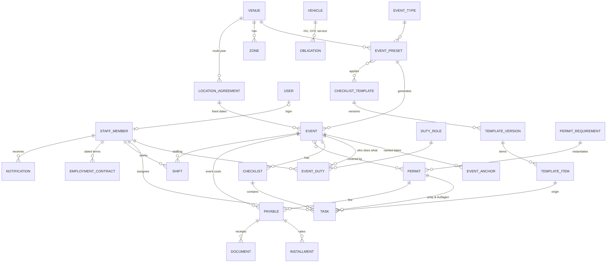

# Data model

Status: **draft v0.3 (2026-10-21)**, revised after the client meeting (research 05) and follow-up research
06–08. Changes from v0.2: **`event` replaces `market`** (ADR 0010), **event presets** (the old website's
"presets") replace market series, **staff members** separate from login users (ADR 0012), time estimates,
permit categories and logbook, staff hours/Minijob, payables & instalments, obligations/vehicles,
inventory & rentals. Once the Drizzle schema exists in `packages/db/src/schema/`, it is the source of
truth and this document is kept in sync with it.

## Principles
1. **Blueprint → instance.** Event types, presets, locations and templates are blueprints. Events, checklists,
   tasks, permits-per-event, shifts and requirements are instances that record their blueprint and version.
2. **Relative dates are stored as rules and as results** (anchor + signed offset + computed `due_at`). Open,
   non-overridden tasks follow anchor changes; done tasks never move.
3. **Several named anchors per event** (event day, setup day, booking cut-off, permit decision, custom).
4. **Templates reference duty roles, not people.** Events map duty roles → staff members (defaults per preset).
5. **Template changes reach existing events only through a deliberate, previewed action** with nothing pre-selected.
6. **Separate status layers** instead of one overloaded status (events: lifecycle vs. booking flags; bookings:
   booking / date / placement / payment / attendance).
7. **Health is computed**; overrides need a reason.
8. **Single entry for money:** a permit fee *is* a payable; marking an instalment paid *is* the expense;
   receipts are evidence attached to it, never summed separately.
9. Single company, no tenant column. **Money in integer cents, lengths in integer centimetres.** Instants are
   `timestamptz`; business dates (event days, due dates of instalments, shift days) are `date` in `Europe/Berlin`.
10. UUID v7 IDs (Better Auth tables keep text IDs). Soft delete via `archived_at`. Issued invoices, time
    records and receipts are never edited silently (versioned or immutable).
11. **Audit log** for every business mutation, in the same transaction.
12. **Legal numbers are data**, never constants (minimum wage, Minijob limit, HU intervals…), with valid-from dates.

## Who's who
| Concept | Table | Notes |
|---|---|---|
| Person working for the company | `staff_member` | Assignable to tasks/shifts; hours tracked; may have **no login**; WhatsApp number + opt-in; magic-link token |
| Login | `user` (Better Auth) | Optional 1:1 link `staff_member.user_id`; has the permission role |
| Responsibility at an event | `duty_role` | Template placeholder (Marktleitung, Aufbau, Büro, Genehmigungen, Kommunikation, Kasse, Wasser/Strom) |
| Outside organisation/person | `contact` | `kind`: authority, landowner, supplier, service, other |
| Vendor (Phase 2) | `vendor` | Never called "customer" |

## Phase 1 ERD (simplified)



## Phase 1 tables

### Access & people
- **user / session / account / verification**: Better Auth *(exists)*. `user.role` = permission role.
- **settings** *(exists)*: company data, IBAN, time zone, Bundesland (`NW`), default due time, reminder policy.
- **staff_member**: `display_name`, `first_name`, `last_name`, `phone_e164`, `whatsapp_opt_in_at`,
  `whatsapp_opt_in_method`, `email?`, `user_id?` (unique), `preferred_duty_role_ids`, `active`,
  `magic_link_version` (bump to revoke all links), notes.
- **duty_role**: `key`, `name_de`, `name_en`, `default_staff_member_id?`, `sort`.

### Event catalogue
- **event_type**: `key` (`flea`, `antique_design`, `design`, `food_wine`, `city_festival`, `theme`, `workshop`,
  `tournament`, `other`), names, colour, rules jsonb: `new_goods_max_share` (e.g. 0.3), `banned_goods`
  (e.g. batteries, phone cases), `online_booking_allowed` (false for food), `default_price_per_m_cents`
  (1500), `default_booking_fee_cents` (250).
- **venue** (location): name, address, lat/lng, city, `kind`, `bundesland`, capacity, access info,
  `landowner_contact_id?`, `custom_fields`, archived_at.
- **zone / row**: zones with rows (`length_cm`, `depth_cm`, `car_allowed`, `car_slots`, `power`, `water`).
  Phase 1 needs zones + capacity; rows matter from M8.
- **event_preset** ("Vorlage", the old website's preset): `event_type_id`, `venue_id`, `name`,
  `public_title`, `public_text` (rich text, for the website later), `price_per_m_cents`, `booking_fee_cents`,
  `default_times` (setup/open/close/teardown), `rrule?`, `default_duties` (duty_role → staff_member),
  `checklist_template_ids`, `permit_requirement_ids` (via venue + type), `equipment_requirements` (M11), active.
- **location_agreement**: `venue_id`, counterparty contact, `valid_from`, `valid_until`, `fixed_dates` (date[]),
  terms, documents. Generates events. Doesn't replace permits.

### Events
- **event**: `preset_id?`, `event_type_id`, `venue_id`, `name`, `starts_on` (date), `ends_on` (date),
  local times, **`status`** (`draft | planned | confirmed | live | completed | closed | cancelled`)
  where *planned* = announced/public but permit not confirmed (not bookable),
  **booking flags**: `booking_open` (bool), `fully_booked` (bool), `car_spaces_full` (bool);
  `price_per_m_cents` (copied from preset, overridable), `booking_fee_cents`, `target_revenue_cents?`,
  `health_override?` + reason, `custom_fields`, notes, `cancelled_reason?`.
- **event_anchor**: `(event_id, key)` → `date`. Keys: `event_day` (= starts_on), `setup_day`, `teardown_day`,
  `booking_cutoff` (default: **Monday before** the event), `permit_decision`, custom. Missing anchor → task has no due date yet.
- **event_duty**: `(event_id, duty_role_id)` → `staff_member_id`. Reassigning reassigns open, not individually
  reassigned tasks of that duty role.

### Templates, tasks, kanban
- **checklist_template**, **template_version** (`draft | published | retired`, immutable when published),
  **template_item** (`stable_key`, title, description, `phase`, `category` (`general | permits | logistics |
  communication | finance | staff`), `anchor_key`, `offset_days`, `day_mode` (`calendar | business`), `due_time?`,
  `duty_role_id?`, `priority`, **`estimate_minutes`**, evidence (`requires_photo`, `requires_note`,
  `requires_attachment`, `check_items`), `requires_approval_by?`, `depends_on_keys`, `condition` (on event
  type/venue attributes), sort).
- **checklist**: `event_id?`, `permit_id?`, `template_version_id?`, name.
- **task**: origin (`event_id?`, `checklist_id?`, `template_item_id?`, `template_stable_key?`, `permit_id?`,
  `payable_id?`, `parent_task_id?`, `source` (`template | manual | permit | permit_condition | obligation |
  rental | email | system`)), title, description, `phase?`, `category`, `priority`, labels;
  assignment (`duty_role_id?`, `assignee_id → staff_member`, `assignee_overridden`); timing (`anchor_key?`,
  `offset_days?`, `day_mode`, `due_at?`, `due_overridden`); **effort** (`estimate_minutes`, `effort_feedback`
  `as_planned | longer | shorter`); state (`status` `todo | in_progress | waiting_external | blocked | done |
  skipped | cancelled`, `waiting_reason?`, `completed_at?`, `completed_by?`, `approval_status?`);
  **kanban** (`board_column?` override, `board_sort`); **carry-over** (`rollover_count`, `last_rolled_at`);
  template tracking (`customized`, `removed_from_template`).
- **task_check_item**, **task_dependency** (doesn't move dates), **task_comment**, **task_watcher**.

### Permits & logbook
- **permit_requirement** (blueprint per venue, optionally narrowed by event type): `category` (`city | external`),
  `permit_type` (`market_permit | water | signage | no_parking | toilets | landowner_ok | gema | safety_concept |
  traffic_order | catering | insurance | other`), title, `authority_contact_id?`, `cadence` (`per_event |
  per_season | per_year | multi_year | standing`), `lead_time_days`, `submission_window_start_md?` /
  `submission_window_end_md?` (month-day, e.g. collected until autumn), `expected_decision_md?` (e.g. January),
  `typical_fee_cents?`, `deliverables` (e.g. `{ stickers: true }`), `prep_template_id?`, notes.
- **permit** (instance): requirement link, `category`, `permit_type`, title, authority, `reference_no`,
  `status` (`not_started | preparing | applied | granted | rejected | not_required | superseded`), `apply_by`,
  `applied_at?`, `expected_decision_on?`, `granted_at?`, `valid_from?`, `valid_until?`, `conditions`,
  `deliverables_received` (e.g. stickers: 100), `responsible_staff_member_id?`, `supersedes_id?`, notes.
  Fees → `payable` (with instalments). Derived flags: `expiring`, `expired`.
- **event_permit**: `(event_id, permit_id, required)`.
- **Logbook** = a view over permits + agreements + (M11) equipment + documents, grouped by location and category,
  showing *held / pending / missing* for upcoming events.

### Staff hours & Minijob (M4)
- **legal_parameter**: `key` (`minimum_wage_cents_per_hour`, `minijob_limit_cents_per_month`,
  `minijob_overrun_ceiling_factor` (2), `minijob_max_overrun_months_12` (2), …), `value`, `valid_from`.
  Seed: 2026-01-01 → 1390 / 60300; 2027-01-01 → 1460 / 63300.
- **employment_contract**: `staff_member_id`, `type` (`minijob | midijob | student | part_time | full_time |
  freelance`), `hourly_rate_cents`, **`contracted_hours_per_week`** (avoid the §12 TzBfG 20-hour fiction),
  `fixed_monthly_pay_cents?` + `working_time_account` (bool), `other_minijob_declared` (bool), `valid_from`, `valid_until?`.
- **shift**: `event_id?`, `staff_member_id`, `duty_role_id?`, `work_date` (date), `planned_start/end`,
  `actual_start/end?`, `break_minutes`, `status` (`requested | confirmed | declined | worked | no_show |
  cancelled`), `recorded_by`, `recorded_at`, `approved_by?`, `approved_at?`, `version` (changes versioned with
  reason in `shift_revision`). Non-event work (office hours) = shift without event.
- **payroll_period**: `month`, `status` (`open | locked | approved | exported`), `locked_at`, `exported_at`,
  export files. Computed per person: hours, gross, remaining allowance, YTD, overrun months.
- **overrun_justification**: staff member, month, reason (needed for the "unforeseeable" exception).

### Payables, receipts, event P&L (M5)
- **payable**: `counterparty_contact_id?`, title, `scope` (`event | company | vehicle`), `event_id?`,
  `vehicle_id?`, `permit_id?`, `rental_id?`, `category` (`location | permit | water_power | equipment_rental |
  staff_external | security | cleaning_waste | toilets | marketing | gema | transport_fuel | vehicle | insurance |
  tax_fees | other`), `total_gross_cents`, `vat_rate_bp?`, `critical` (bool: landlord/permit/penalty), status
  (derived from instalments), notes.
- **installment**: `payable_id`, `due_on` (date), `amount_cents`, `status` (`open | partially_paid | paid |
  cancelled`), `paid_on?`, `paid_amount_cents?`, `paid_by?`, `method?`, `reference?`.
- **expense**: ad-hoc purchase already paid (fuel, cable ties): date, amount, category, event/vehicle, paid_by.
- **document**: file + `sha256`, `kind` (`receipt | invoice | e_invoice_xml | contract | permit | photo | other`),
  links (payable/installment/expense/permit/event/vehicle), uploaded_by. Immutable; soft delete with audit;
  e-invoice XML stored byte-identical.
- **event budget** = view: per category **plan** (`event_budget_line`), **committed** (payables), **actual**
  (paid instalments + expenses); revenue lines from bookings (M9) and other income (`event_income`).

### Company tab: obligations & vehicles (M6)
- **vehicle**: plate, model, VIN, first registration, `gross_weight_kg` (→ HU interval), odometer, insurer,
  policy, notes.
- **obligation**: title, `scope` (`company | vehicle | venue`), `vehicle_id?`, `interval_months?`, `interval_km?`,
  `next_due_on?`, `next_due_km?`, `lead_days`, `responsible_staff_member_id`, `creates_payable` (bool),
  `last_done_on?`. Completing records date/cost/document and rolls forward. Seeds: HU, UVV (DGUV 70) yearly,
  service, tyres, insurances, vehicle tax, licence check (6-monthly practice; store date + checker only), KSK
  report 31 March.
- **vehicle_issue**: vehicle, reported_by, photo, severity, status.

### Notifications & messaging
- **notification**: `recipient_staff_member_id`, reason (`assigned | mentioned | due_soon | overdue |
  rolled_over | dates_shifted | permit_apply_by | permit_decision_due | installment_due | rental_return_due |
  obligation_due | shift_request | hours_missing | payroll_close | escalated`), subject, title, body, link,
  severity, `dedupe_key`, state (`unread | read | done | saved`), `snoozed_until?`.
- **outbound_message**: channel (`in_app | email | whatsapp_link | whatsapp_api`), recipient, template key,
  rendered text, `status` (`queued | ready | sent | delivered | read | failed`), `send_after` (debounce/quiet hours),
  external id. For `whatsapp_link`, "sent" is set when the office clicks the wa.me button.
- **escalation_log**; **notification_preference**.

### Files, KB, audit
**file / file_link** (as before), **kb_article** (+ revisions), **audit_log** *(exists)*.

## Key algorithms (Phase 1)

### Generating events from a preset or agreement (one service path)
```
createEvent(preset | agreement, date):
  tx: insert event (copy price/times/type), anchors (event_day, booking_cutoff = previous Monday, …)
      duties ← preset.default_duties
      for template in preset.templates (current published version): checklist + tasks
          (due_at from anchor/offset/day_mode; assignee from duty; estimate from item)
      logbook fill: for each permit requirement of venue/type:
          valid covering permit exists → link (ticked, with document link)
          else → new permit (apply_by = event_day − lead_time, or window end) + prep tasks
      (M11) equipment requirements ← preset
      audit; grouped "assigned" notifications (debounced)
```

### Kanban columns (derived, overridable)
`Erledigt` if done; `Heute` if due today or overdue (rolled over); `Diese Woche` if due ≤ 7 days;
else `Vorbereitung`. A manual move sets `board_column` until the due date passes.

### Carry-over (nightly, 00:05)
Open tasks with `due_at < today` → `rollover_count += 1`; included in tomorrow's digest; at 3 → notify manager.

### Deadline sweep & escalation (every 15 min, idempotent)
Reminders by `dedupe_key` (incl. due date). Overdue → assignee; +1 day → **manager** (decision 2026-10-21;
duty-role-specific escalation later). Covers tasks, permit apply-by/decision dates, instalments, rentals,
obligations, missing time records (day 5 → staff + manager, day 7 = legal deadline).

### Minijob allowance (pure function in `@marktwerk/core`)
```
limit = legal_parameter(minijob_limit, month)
earned_month = Σ (worked + planned hours × rate)            → amber if > limit
red if earned_month > limit × 2, or overrun months in rolling 12 ≥ 2 already, or YTD forecast > 12 × limit
remaining_hours = max(0, limit − earned_month) / rate
```

### Template propagation (deliberate)
Publishing creates version n+1 and changes nothing else. "Apply to events…" opens a picker with **no events
pre-selected**, a per-event preview and the merge rules (add / update non-customized open tasks / cancel
untouched removed tasks; done tasks, comments, evidence never touched).

## Phase 2 sketch: bookings (M7–M10)
- **vendor**: kind (private/commercial), name, contact, categories (antique, design, handmade, food…), default
  length, car + car length, documents, `is_regular`, notes incl. vendor talks, `legacy_id`, newsletter consent
  (`consent_basis`: `soft_opt_in | double_opt_in`, `unsubscribed_at`).
- **booking_request** (one per event, after splitting multi-date requests): `source` (`legacy_web | email |
  phone | walk_in`), `legacy_ref` / `message_id` (idempotency), raw payload, `status` (`new | in_review |
  accepted | waitlisted | declined | withdrawn`).
- **booking_date** (vendor × event): `length_cm`, **`car_requested`, `car_granted`**, `car_length_cm?`,
  `price_snapshot`, discounts (e.g. first event free), placement (`row_id`, `start_cm`, `end_cm`, status
  `unplaced | proposed | assigned`), payment (`not_due | open | partially_paid | paid | overdue`), attendance.
- **stall_ticket** (Platzkarte PDF), **invoice / invoice_line / invoice_recipient / number_sequence**,
  **payment_check_session** + `bank_line` (imported CSV/CAMT) + `payment_match`.
- **reminder** (manual, logged: who/when/template).
- **mailbox / email_thread / email_message / thread_link / reply_template** (M10).

## Phase 2–3 sketch: inventory (M11), field, maps, communication
- **item_type** (bulk; `tracking` column reserved), **preset_requirement / event_requirement** (qty),
  availability = owned − out_of_service − overlapping requirements (setup→teardown window) + active rentals;
  **rental** (supplier, item, qty, events, pickup, `due_return_on`, returned_at, deposit, late fee terms,
  meter readings, responsible).
- **day_sheet**, **check_in**, **incident**, **vendor_note** (talks), **venue_layout / event_layout** (maps),
  **comm_item** (per event & channel: website, newsletter, social, flyer, poster: status, dates, sticker count),
  **media_asset** (photos per event, consent flag).
