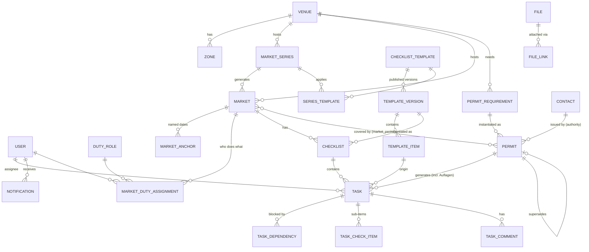

# Data model

Status: **draft v0.2**, revised after the product teardowns ([research 02–04](../research/)).
Phase-1 tables are designed in detail. Later phases are sketched so Phase 1 doesn't paint us
into a corner. Once the Drizzle schema exists, `packages/db/src/schema/` is the source of truth
and this document is kept in sync with it.

## Principles

1. **Blueprint → instance.** Venues, series and templates are long-lived blueprints. Markets,
   checklists, tasks and permits are instances created from them. An instance records which
   blueprint *version* it came from, so changes can be pushed to *future* instances on purpose
   without rewriting history. (Crescat event types; Process Street versioned runs.)
2. **Relative dates are stored as rules and as results.** A task stores its anchor + offset
   *and* the computed `due_at`. When an anchor date changes, open tasks that weren't edited by
   hand are recalculated. Done tasks never move. (Paperless Pipeline trigger dates; ClickUp
   "don't move closed items".)
3. **Several named anchors per market**, not one. T-30 *before* and T+2 *after*
   both work. (The Asana single-anchor pain point.)
4. **People are not hard-coded in templates.** Templates reference *duty roles*. Each market maps
   duty roles to people, with defaults per series. (Asana/Manifestly role placeholders.)
5. **Separate status layers instead of one overloaded status** (decisive for bookings in Phase 2,
   see research 02).
6. **Health is computed, not hand-set**; an override needs a written reason. (Asana portfolio drift.)
7. **Single company, no tenant column.** Company-wide settings live in one `settings` row.
8. **Money in integer cents** (`*_cents`, EUR). **Lengths in centimetres** (`*_cm`).
9. **Time:** `timestamptz` (UTC) for instants. Market days are `date` + local `time` in the company
   time zone (`Europe/Berlin`). Relative deadlines keep their wall-clock time across DST
   (`resolveRelativeDue` in `@marktwerk/core`).
10. **IDs:** UUID v7 generated in the app (auth tables use Better Auth's text IDs).
11. **Soft delete** (`archived_at`) for business records. Issued invoices are immutable (GoBD).
12. **Audit everything that matters** in `audit_log`, in the same transaction as the change.
13. **Custom fields** (`custom_fields jsonb`) on venue and market, with definitions in settings,
    so new facts like gate codes or landlord references don't each need a migration. (Crescat metadata.)

## Two kinds of roles

| | Permission role | Duty role |
|---|---|---|
| What | What a user may *do* in the system | What a person *is responsible for* at a market |
| Values | `owner`, `manager`, `staff`, `field` (fixed, `@marktwerk/core`) | Configurable: Marktleitung, Aufbau-Team, Büro/Buchung, Genehmigungen, Kasse… |
| Where | `user.role` | `duty_role` table; mapped per series and per market |
| Used by | `can()` checks | Template items, task assignment, filters |

## Phase 1 entity-relationship diagram



## Phase 1 tables

### People & access
- **user / session / account / verification**: Better Auth (exists, see `schema/auth.ts`). Extra
  columns: `role` (permission role), `locale`, `phone`. Deactivation uses the admin plugin's `banned`.
- **settings** (single row): company master data, IBAN, time zone, default due time, reminder
  policy, `bundesland` (for public holidays), custom field definitions. *(exists)*
- **duty_role**: `key` (`market_lead`, `setup_crew`, `office`, `permits`, `cash`…), `name_de`, `name_en`,
  `default_user_id?`, `sort`.

### Venues, contacts
- **venue**: name, slug, address, lat/lng, `kind` (`outdoor_public | outdoor_private | indoor`),
  `bundesland`, `capacity_cm`, access notes (gate code etc. in `custom_fields`), default times
  (setup/open/close/teardown), `landowner_contact_id`, `custom_fields`, `archived_at`.
- **zone**: `venue_id`, `name`, `code`, `kind` (`rows | fixed_slots | free_area`), `capacity_cm`,
  `sort`. **row** comes in Phase 2: length, depth, car allowed, power, corner ends.
- **contact**: external person/organisation. `kind` (`authority | landowner | supplier | service | other`),
  organisation, name, email, phone, address, notes. Authorities are contacts of `kind = authority`.

### Markets
- **market_series**: `venue_id`, name, `rrule` (RFC 5545), season start/end, default times,
  `default_duty_assignments` (jsonb: duty_role → user), active.
  Generating markets is an explicit, previewable action ("pick dates in a calendar → generate N").
- **market**: `venue_id`, `series_id?`, name, `market_date`, `end_date?`, local times,
  `status` (`draft | planned | confirmed | live | completed | cancelled`), `capacity_cm_override`,
  `target_revenue_cents`, flags (`is_sunday_or_holiday` computed, `commercial_allowed`, `new_goods_allowed`),
  `health_override` + `health_override_reason`, `custom_fields`, notes.
- **market_anchor**: `(market_id, key)` → `date`. Keys: `market_day` (always = `market_date`),
  `setup_day`, `booking_open`, `booking_close`, `season_start`, plus custom keys. A template item
  whose anchor is missing gets **no due date** until the anchor is set.
- **market_duty_assignment**: `(market_id, duty_role_id)` → `user_id`. Pre-filled from the series.
  Changing it reassigns all open tasks for that duty role that weren't individually reassigned.

### Templates (versioned)
- **checklist_template**: name, description, `scope` (`market | permit | general`),
  `current_version_id`, active.
- **template_version**: `template_id`, `version` (int), `status` (`draft | published | retired`),
  `published_at`, `published_by`, `changelog`. Published versions are immutable; editing creates a
  new draft.
- **template_item**: `version_id`, `stable_key` (uuid kept across versions, used for propagation),
  title, description (rich text), `phase` (`pre | live | post`),
  `anchor_key` (default `market_day`), `offset_days` (signed), `day_mode` (`calendar | business`),
  `due_time?`, `duty_role_id?`, `priority` (`low | normal | high | critical`),
  **evidence**: `requires_photo`, `min_photos`, `requires_note`, `requires_attachment`,
  `check_items` (jsonb list of sub-items), `requires_approval_by` (duty role or permission role),
  `depends_on_keys` (stable keys), `condition` (jsonb on market attributes, e.g. `{ "venue.kind": "indoor" }`),
  `sort`.
- **series_template**: `(series_id, template_id)` lists the templates auto-applied to markets of the
  series. **venue_template** does the same for one-off markets at a venue.

### Checklists & tasks
- **checklist**: `market_id?`, `permit_id?`, `template_version_id?`, name.
- **task**:
  - origin: `market_id?`, `checklist_id?`, `template_item_id?`, `template_stable_key?`, `permit_id?`,
    `parent_task_id?`, `source` (`template | manual | permit | permit_condition | email | system`), `source_ref?`
  - content: title, description, `phase?`, `priority`, `labels`
  - assignment: `duty_role_id?`, `assignee_id?`, `assignee_overridden` (bool)
  - timing: `anchor_key?`, `offset_days?`, `day_mode`, `due_at?`, `due_overridden` (bool)
  - state: `status` (`todo | in_progress | waiting_external | blocked | done | skipped | cancelled`),
    `waiting_reason?`, `completed_at?`, `completed_by?`, `completion_note?`,
    `approval_status?` (`pending | approved | rejected`), `approved_by?`
  - template tracking: `customized` (bool, set on manual edit of content), `removed_from_template` (bool)
  - sort, timestamps, created_by
- **task_check_item**: `task_id`, label, `done`, `done_by`, `done_at`, sort.
- **task_dependency**: `(task_id, depends_on_task_id)`. Dependencies **don't move dates**. They
  block status and notify the next assignee when the blocker completes.
- **task_comment**: task_id, author_id, body, timestamps. Mentions create notifications.
- **task_watcher**: `(task_id, user_id)`.

### Permits
- **permit_requirement** (blueprint per venue): `venue_id`, `permit_type`, title, `authority_id?`,
  `cadence` (`per_market | per_season | per_year | standing`), `lead_time_days`, `processing_days`,
  `renewal_reminder_days` (int[]), `checklist_template_id?` (preparation steps), notes.
- **permit** (instance): `requirement_id?`, `venue_id?`, `permit_type`, title, `authority_id?`,
  `reference_no`, `status` (`not_started | preparing | applied | granted | rejected | not_required | superseded`),
  `apply_by` (date), `applied_at?`, `granted_at?`, `valid_from?`, `valid_until?`, `fee_cents?`,
  `conditions` (rich text, Auflagen), `responsible_user_id?`, `supersedes_id?`, notes.
  `expiring` and `expired` are **derived** from `valid_until`, not stored.
- **market_permit**: `(market_id, permit_id, required)`. One annual §69 designation covers many
  dates; a per-market Sondernutzung covers one.
- `permit_type` enum (seeded from research 01): `market_designation` (§69 GewO), `special_use`
  (Sondernutzung), `traffic_order`, `sunday_exemption`, `temporary_catering` (GastG §12), `gema`,
  `safety_concept`, `fire_safety`, `landowner_contract`, `insurance`, `waste`, `other`.

### Files
- **file** (storage key, filename, mime, size, sha256, uploaded_by) + **file_link** (`entity_type`,
  `entity_id`, `label?`, `kind`: `document | photo_evidence | attachment`). Polymorphic on purpose;
  integrity is checked in the service layer, plus an orphan cleanup job. Storage goes through an
  S3-compatible adapter (local disk in dev).

### Notifications
- **notification**: one row per **(user, subject, reason)**. New activity *updates and bumps* it
  rather than adding duplicates (GitHub-style). Fields: `user_id`, `reason` (`assigned | mentioned |
  due_soon | overdue | blocker_cleared | dates_shifted | permit_apply_by | permit_expiring |
  approval_requested | escalated`), `subject_type`, `subject_id`, title, body, link, `severity`,
  `dedupe_key` (unique per user), `state` (`unread | read | done | saved`), `snoozed_until?`
  (cleared early by new activity), `emailed_at?`, timestamps.
- **notification_preference**: per user × reason: `in_app`, `email` (`off | instant | digest`).
- **escalation_log**: every reminder/escalation step (who, what, when), for traceability.

### Knowledge base & audit
- **kb_article** (+ `kb_article_revision`): title, slug, TipTap JSON, plain text for search, category,
  tags, `venue_id?`, pinned.
- **audit_log** *(exists)*.

## Key algorithms (Phase 1)

### Instantiating a market (single code path for UI, bulk generation and API)
```
instantiateMarket(market):
  tx:
    anchors = { market_day: market.market_date, ...series/venue defaults }
    duties  = series.default_duty_assignments
    for template in series.templates ∪ venue.templates:
      version = template.current published version
      checklist = insert checklist(version)
      for item in version.items where condition(item, market):
        insert task(from item,
          due_at = anchors[item.anchor_key] ? resolve(anchors[...], item.offset_days, item.day_mode, item.due_time) : null,
          duty_role = item.duty_role, assignee = duties[item.duty_role])
      wire task_dependency from item.depends_on_keys
    for req in venue.permit_requirements:
      per_market → new permit(apply_by = market_date − lead_time) + its preparation tasks
      per_season/per_year/standing → link existing valid permit via market_permit, or create one
    audit + one grouped "assigned" notification per assignee
```
Bulk generation from a series calls this once per selected date inside one job, with a preview first.

### Changing an anchor (e.g. moving a market date)
Recompute `due_at` for tasks with that `anchor_key`, `status` open and `due_overridden = false`.
Recompute `apply_by` for per-market permits not yet applied for. **Show a preview** ("14 tasks
move +7 days, 2 overridden tasks stay"), apply, and send **one grouped `dates_shifted`
notification per assignee**. No push notification for automated shifts.

### Business days
`day_mode = business` skips weekends and public holidays of the venue's Bundesland. "Before" tasks
roll **earlier**, "after" tasks roll **later**. Holidays come from a small holiday module in
`@marktwerk/core` (computed Easter-based rules, no external API).

### Propagating a template change (explicit, previewed)
Publishing version n+1 never changes existing markets by itself. "Apply to markets…" offers
**all future markets / selected markets / none**, with a per-market preview. Merge rules, matched by `stable_key`:
- new item → add task (flag `late_added` if its due date already passed)
- changed item → update tasks that are open and not `customized` (offset/role only if not overridden)
- removed item → cancel if not started, otherwise keep and set `removed_from_template`
- done tasks, comments, evidence: **never touched**

Also supported the other way: **"update template from this market"** (lessons learned) opens a
new draft version prefilled with the market's custom tasks.

### Deadline sweep and escalation (the "nothing slips" engine)
Every 15 min, idempotent (deterministic `dedupe_key` that includes `due_at`, so moved deadlines re-arm):
```
for open tasks with due_at:
  dueState(due_at, now, reminderDays(priority)) → due_soon(n) | overdue
  notify assignee (or all holders of the duty role if unassigned)
  escalation ladder: overdue → assignee; +1 d → + managers; +3 d → shows on boss view (no push)
for permits: apply_by reminders (30/14/7 d), valid_until reminders (90/30/7/0 d)
  → responsible user AND managers (never only the holder)
```
Unassigned open tasks (duty role not mapped) appear in an **"unassigned" queue** and count on the
boss view. They're never silently dropped.

### Market health (computed)
Per market, each area is green/yellow/red:
- **Permits:** red if a required permit isn't granted by its `apply_by` + processing days, or not granted by T-7.
- **Tasks:** red if any critical task is overdue; yellow if any task is overdue or > 20% of due tasks are open.
- **Assignments:** yellow if any duty role is unmapped.
- (Phase 2) **Occupancy:** booked metres vs capacity/target.

Overall = worst area, unless `health_override` (with a mandatory reason).

## Phase 2 sketch: bookings, vendors, invoices, inbox

Status layers per research 02:

| Layer | Values |
|---|---|
| **booking** (vendor × series or market) | `inquiry → submitted → needs_info → approved / waitlisted / declined / withdrawn` |
| **booking_date** (per market day) | `requested → accepted / waitlisted / rejected`, later `cancelled_by_vendor` (`in_time`/`late`) / `cancelled_by_organizer` |
| **placement** | `unplaced → proposed → held (expires_at) → assigned` |
| **invoice** | `draft → issued (open) → partially_paid → paid` (+ `overdue` derived, `voided` via Storno, `credited`) |
| **attendance** | `expected → checked_in / approved_absence / unapproved_absence / no_show` (explicit day close-out) |

- **vendor**: kind (private/commercial), contact data, categories, default length/depth, car + car length,
  power need, documents with type + expiry, `is_regular`, priority score, GDPR consent and retention date.
- **row** (zone child): `length_cm`, `depth_cm`, `car_allowed`, `power_points`, `corner_ends`.
- **placement** = metre interval on a row (`start_cm`, `end_cm`); fixed slots are pre-cut intervals.
- **regular_spot** (Stammplatz, a *preference*): vendor, row, `start_cm`, `length_cm`, priority.
  "Apply regulars" creates `proposed` placements + a conflict list.
- **price_rule**: per venue/zone/category: €/m, min/max length, flat-up-to-X, volume breaks; add-ons
  (car, van, corner, power) with min-length conditions; tax code per line (§4 Nr. 12 exempt / 19%).
- **invoice / invoice_line / payment / number_sequence** (gap-free per year), draft → release.
- **mailbox / email_thread / email_message / email_attachment / thread_link / reply_template**
  (see [overview.md](./overview.md#microsoft-365-mailbox-integration-phase-2)).
- **category_cap**: per market: category → max vendors; "same product" cap; exemptions.

## Phase 3 sketch
**cash_session / cash_entry** (shape depends on the KassenSichV decision, see open questions),
**check_in**, **incident** (append-only), **venue_layout** (background image, row geometry jsonb),
**market_layout** (snapshot per date), **day_sheet** (generated snapshot), **qr_pass**.
