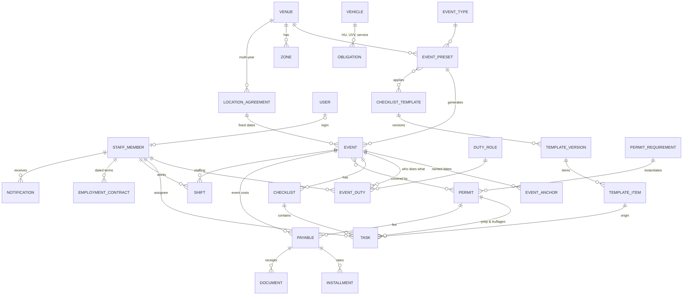

# Data model

Status: **draft v0.5 (2026-10-21)**. Change in v0.5: the Phase 1 schema for M2–M6 exists (migration
`0002_phase1_modules`); where it deliberately differs from this text the line is marked "(implemented 0002: …)".
Table list by file in `packages/db/src/schema/`: `templates.ts`, `tasks.ts`, `permits.ts`, `notifications.ts`,
`staff.ts`, `money.ts`, `company.ts`, `documents.ts`. Change in v0.4: `workspace` removed; `user_preference` keeps theme, density,
sidebar and `saved_views` (ADR 0019, classic screens). v0.3 was revised after the client meeting (research 05) and
follow-up research 06–08. Changes from v0.2: **`event` replaces `market`** (ADR 0010), **event presets** (the old website's
"presets") replace market series, **staff members** separate from login users (ADR 0012), time estimates,
permit categories and logbook, staff hours/Minijob, payables & instalments, obligations/vehicles,
inventory & rentals. Once the Drizzle schema exists in `packages/db/src/schema/`, it is the source of
truth and this document is kept in sync with it.

## Principles
1. **Blueprint → instance.** Event types, presets, locations and templates are blueprints. Events, checklists,
   tasks, permits-per-event, shifts and requirements are instances that record their blueprint and version.
2. **Relative dates are stored as rules and as results** (anchor + signed offset + computed `due_at`). Open,
   non-overridden tasks follow anchor changes; done tasks never move.
3. **Several named anchors per event** (event day, setup day, booking cut-off, permit decision, custom).
4. **Templates reference duty roles, not people.** Events map duty roles → staff members (defaults per preset).
5. **Template changes reach existing events only through a deliberate, previewed action** with nothing pre-selected.
6. **Separate status layers** instead of one overloaded status (events: lifecycle vs. booking flags; bookings:
   booking / date / placement / payment / attendance).
7. **Health is computed**; overrides need a reason.
8. **Single entry for money:** a permit fee *is* a payable; marking an instalment paid *is* the expense;
   receipts are evidence attached to it, never summed separately.
9. Single company, no tenant column. **Money in integer cents, lengths in integer centimetres.** Instants are
   `timestamptz`; business dates (event days, due dates of instalments, shift days) are `date` in `Europe/Berlin`.
10. UUID v7 IDs (Better Auth tables keep text IDs). Soft delete via `archived_at`. Issued invoices, time
    records and receipts are never edited silently (versioned or immutable).
11. **Audit log** for every business mutation, in the same transaction.
12. **Legal numbers are data**, never constants (minimum wage, Minijob limit, HU intervals…), with valid-from dates.

## Who's who
| Concept | Table | Notes |
|---|---|---|
| Person working for the company | `staff_member` | Assignable to tasks/shifts; hours tracked; may have **no login**; WhatsApp number + opt-in; magic-link token |
| Login | `user` (Better Auth) | Optional 1:1 link `staff_member.user_id`; has the permission role |
| Responsibility at an event | `duty_role` | Template placeholder (Marktleitung, Aufbau, Büro, Genehmigungen, Kommunikation, Kasse, Wasser/Strom) |
| Outside organisation/person | `contact` | `kind`: authority, landowner, supplier, service, other |
| Vendor (Phase 2) | `vendor` | Never called "customer" |

## Phase 1 ERD (simplified)



## Phase 1 tables

### Access & people
- **user / session / account / verification**: Better Auth *(exists)*. `user.role` = permission role.
- **settings** *(exists)*: company data, IBAN, time zone, Bundesland (`NW`), default due time, reminder policy, `email_enabled` (master switch for outgoing email, default `false`: while off the jobs queue no email and `send-emails` delivers none, in-app notifications are unaffected) and `daily_digest_enabled` (the 07:00 digest additionally needs this on) and `permit_horizon_days` (integer 7–180, default 30, check constraint: how many days before the apply-by date, or the expected decision once filed, permits appear in the Übersicht; beyond 7 days they form the group "Genehmigungen demnächst"; tasks and other due items keep 7 days).
- **staff_member**: `display_name`, `first_name`, `last_name`, `phone_e164`, `email?`, `user_id?` (unique),
  `preferred_duty_role_ids`, `active`, notes. (The synthetic dataset marks future login users with
  `permissionRole`; the seed creates their Better Auth users.) Phase 2 (M7) adds `whatsapp_opt_in_at`, `whatsapp_opt_in_method`,
  `magic_link_version` (bump to revoke all links).
- **duty_role**: `key`, `name_de`, `name_en`, `default_staff_member_id?`, `sort`.

### Event catalogue
- **event_type**: `key`: seeded **`flea`, `antique`, `city_festival`, `food_wine`** (current business); future
  types (design, workshop, tournament) are added as data later. Names, colour, rules jsonb: `new_goods_max_share` (e.g. 0.3), `banned_goods`
  (e.g. batteries, phone cases), `online_booking_allowed` (false for food), `default_price_per_m_cents`
  (1500), `default_booking_fee_cents` (250).
- **venue** (location): name, address, lat/lng, city, `kind`, `bundesland`, capacity, access info,
  `landowner_contact_id?`, `custom_fields`, archived_at.
- **zone / row**: zones with rows (`length_cm`, `depth_cm`, `car_allowed`, `car_slots`, `power`, `water`).
  Phase 1 needs zones + capacity; rows matter from M8.
- **event_preset** ("Vorlage", the old website's preset): `event_type_id`, `venue_id`, `name`,
  `public_title`, `public_text` (rich text, for the website later), `price_per_m_cents`, `booking_fee_cents`,
  `default_times` (setup/open/close/teardown), `rrule?`, `default_duties` (duty_role → staff_member),
  `checklist_template_ids`, `permit_requirement_ids` (via venue + type), `equipment_requirements` (M11), active,
  **`color`** (Marktfarbe: a key of the palette in `packages/core/src/events/market-colors.ts`, shown as a thin
  bar next to the market's name; assigned as the least used one when a market is created, editable in the
  market editor; null = fall back to the event type's colour). A preset is a real market ("Flohmarkt Nippes")
  with its venue built in (decision 2026-10-22).
- **location_agreement**: `venue_id`, counterparty contact, `valid_from`, `valid_until`, `fixed_dates` (date[]),
  terms, documents. Generates events. Doesn't replace permits.

### Events
- **event**: `preset_id?`, `event_type_id`, `venue_id`, `name`, `starts_on` (date), `ends_on` (date),
  local times, **`status`** (`draft | planned | confirmed | live | completed | closed | cancelled`)
  where *planned* = announced/public but permit not confirmed (not bookable). **New events start as `planned`**
  (they go online before permits are in); `draft` is only reached by a manual change. A planned event becomes
  `confirmed` **automatically** once it has at least one required permit and all of them are granted
  (`shouldAutoConfirm`, evaluated by `autoConfirmEvents` after a permit is granted, linked or marked "not
  needed", and at the end of the logbook fill; audit `event.status` with `auto: true`, notification reason
  `event_confirmed`). No required permit → stays planned (manual confirmation). Never moves back,
  the permit health keeps showing a withdrawn permit,
  **booking flags**: `booking_open` (bool), `fully_booked` (bool), `car_spaces_full` (bool);
  `price_per_m_cents` (copied from preset, overridable), `booking_fee_cents`, `target_revenue_cents?`,
  `health_override?` + reason, `custom_fields`, notes, `cancelled_reason?`.
- **event_anchor**: `(event_id, key)` → `date`. Keys: `event_day` (= starts_on), `setup_day`, `teardown_day`,
  `booking_cutoff` (default: **Monday before** the event), `permit_decision`, custom. Missing anchor → task has no due date yet.
- **event_duty**: `(event_id, duty_role_id)` → `staff_member_id`. Reassigning reassigns open, not individually
  reassigned tasks of that duty role.

### Templates, tasks, kanban
- **checklist_template**, **template_version** (`draft | published | retired`, immutable when published),
  **template_item** (`stable_key`, title, description, `phase`, `category` (`general | permits | logistics |
  communication | finance | staff`), `anchor_key`, `offset_days`, `day_mode` (`calendar | business`), `due_time?`,
  `duty_role_id?`, `priority`, **`estimate_minutes`**, evidence (`requires_photo`, `requires_note`,
  `requires_attachment`, `check_items`), `is_key` (Kernaufgabe, manual flag, copied to the task by
  instantiation and propagation), `requires_approval_by?`, `depends_on_keys`, `condition` (on event
  type/venue attributes), sort).
  *(implemented 0002: `task_category` also has `office` (the synthetic Büro tasks); `phase` is `pre | live | post`;
  `priority` is `low | normal | high`; `checklist_template.kind` (`event | permit`, a permit-prep template has
  kind `permit`) and `event_type_id?`; `template_version` has `published_at`, `published_by_id`, `change_note`, a
  partial unique index allows **one draft** per template; `requires_approval_by` is `approver_duty_role_id` (a
  role, not a person, principle 4); the preset → templates link is the table **`event_preset_template`**
  `(preset_id, template_id, sort)` that stands for "`checklist_template_ids`".)*
  *(0007: **`checklist_template.is_master`**, a partial unique index allows exactly one: the Grundvorlage, the basic
  tasks every market starts with, edited in Einstellungen → Bibliothek and linked to no preset; it cannot be
  archived. **`checklist_template.owner_preset_id`** marks a market's own template: `createMarket` copies the
  master's published version (items with their stable keys) into a new template named "<Markt> – Aufgaben",
  publishes it as v1 and links it through `event_preset_template`; from then on it is independent of the master
  (no propagation). Existing presets keep their links to the per-type templates. Library lists of "other"
  templates exclude the master and owned copies.)*
- **checklist**: `event_id?`, `permit_id?`, `template_version_id?`, name. *(implemented 0002: + `template_id?`, `sort`,
  `archived_at`; a check forbids both `event_id` and `permit_id`.)*
- **task**: origin (`event_id?`, `checklist_id?`, `template_item_id?`, `template_stable_key?`, `permit_id?`,
  `payable_id?`, `parent_task_id?`, `source` (`template | manual | permit | permit_condition | obligation |
  rental | email | system`)), title, description, `phase?`, `category`, `priority`, labels;
  assignment (`duty_role_id?`, `assignee_id → staff_member`, `assignee_overridden`); timing (`anchor_key?`,
  `offset_days?`, `day_mode`, `due_at?`, `due_overridden`); `is_key` (Kernaufgabe: editable on the task, ranks first in the Übersicht due list); **effort** (`estimate_minutes`, `effort_feedback`
  `as_planned | longer | shorter`); state (`status` `todo | in_progress | waiting_external | blocked | done |
  skipped | cancelled`, `waiting_reason?`, `completed_at?`, `completed_by?`, `approval_status?`);
  **kanban** (`board_column?` override, `board_sort`); **carry-over** (`rollover_count`, `last_rolled_at`);
  template tracking (`customized`, `removed_from_template`).
  *(implemented 0004: **`snoozed_until date?`**, a Berlin calendar date. A task is snoozed while it is after today and is
  back on the date itself (no job); the due date is untouched. Snoozed tasks are left out of the Übersicht due list and
  KPIs, the weekend blockers, the Kalender "Aufgaben" layer, the deadline sweep (reminders, escalation) and the daily
  digest; they stay on the board with a "Zurückgestellt bis …" badge. Set and cleared through `snoozeTask` /
  `unsnoozeTask` (audit `task.snooze` / `task.unsnooze`, undoable).)*
  *(implemented 0002: task also has `obligation_id?` (source `obligation`), `skipped_reason`, the copied evidence
  flags `requires_photo/note/attachment`, `approver_staff_member_id?`, `completed_by_staff_member_id`; `board_column`
  is the enum `preparation | this_week | today | done`; `board_sort` is a double (fractional ordering);
  `labels` is `text[]`. Constraints: `status = done` needs `completed_at`; a partial unique index
  `(checklist_id, template_stable_key)` makes instantiation idempotent. `event_id` is nullable (company/permit tasks).)*
- **task_check_item**, **task_dependency** (doesn't move dates), **task_comment**, **task_watcher**.
  *(implemented 0002: a comment has `author_staff_member_id?` and `author_user_id?` (an office login may have no staff
  record), `mentioned_staff_member_ids`, `edited_at`, `archived_at`. **No UI offers comments any more** (client decision
  2026-10-22, single user): the table and its data stay, nothing in the drawer shows or creates comments, and
  comment/mention notifications are no longer produced from the UI. `requires_note` no longer blocks completion; when
  marking a task done an optional note is kept in the `task.status` / `task.move` audit entry (`diff.note`) and shown
  in the drawer ("Notiz") and the activity.)*

### Permits & logbook
- **permit_requirement** (blueprint per venue, optionally narrowed by event type): `category` (`city | external`),
  `permit_type` (`market_permit | water | signage | no_parking | toilets | landowner_ok | gema | safety_concept |
  traffic_order | catering | insurance | other`), title, `authority_contact_id?`, `cadence` (`per_event |
  per_season | per_year | multi_year | standing`), `lead_time_days`, `submission_window_start_md?` /
  `submission_window_end_md?` (month-day, e.g. collected until autumn), `expected_decision_md?` (e.g. January),
  `typical_fee_cents?`, `deliverables` (e.g. `{ stickers: true }`), `prep_template_id?`, notes.
- **permit** (instance): requirement link, `category`, `permit_type`, title, authority, `reference_no`,
  `status` (`not_started | preparing | applied | granted | rejected | not_required | superseded`), `apply_by`,
  `applied_at?`, `expected_decision_on?`, `granted_at?`, `valid_from?`, `valid_until?`, `conditions`,
  `deliverables_received` (e.g. stickers: 100), `responsible_staff_member_id?`, `supersedes_id?`, notes.
  Fees → `payable` (with instalments). Derived flags: `expiring`, `expired`.
  *(implemented 0002: `permit` also has `venue_id?` and `season?` (denormalised from the requirement so the logbook
  groups by location without a join and ad-hoc permits work); all dates are `date`; `apply_by`, `status` default
  `not_started`; `conditions` is `text[]`; `permit_requirement.event_type_id?`, `archived_at`; month-days are text
  `MM-DD` with a check; `permit_type` has the full list of the data model, the synthetic data uses six.)*
- **event_permit**: `(event_id, permit_id, required)`. *(implemented 0002: primary key `(event_id, permit_id)`.)*
- **Logbook** = a view over permits + agreements + (M11) equipment + documents, grouped by location and category,
  showing *held / pending / missing* for upcoming events.

### Staff hours & Minijob (M4; times entered by the office in Phase 1, by staff via magic link from M7)
- **legal_parameter**: `key` (`minimum_wage_cents_per_hour`, `minijob_limit_cents_per_month`,
  `minijob_overrun_ceiling_factor` (2), `minijob_max_overrun_months_12` (2), …), `value`, `valid_from`.
  Seed: 2026-01-01 → 1390 / 60300; 2027-01-01 → 1460 / 63300.
- **employment_contract**: `staff_member_id`, `type` (`minijob | midijob | student | part_time | full_time |
  freelance`), `hourly_rate_cents`, **`contracted_hours_per_week`** (avoid the §12 TzBfG 20-hour fiction),
  `fixed_monthly_pay_cents?` + `working_time_account` (bool), `other_minijob_declared` (bool), `valid_from`, `valid_until?`.
- **shift**: `event_id?`, `staff_member_id`, `duty_role_id?`, `work_date` (date), `planned_start/end`,
  `actual_start/end?`, `break_minutes`, `status` (`requested | confirmed | declined | worked | no_show |
  cancelled`), `recorded_by`, `recorded_at`, `approved_by?`, `approved_at?`, `version` (changes versioned with
  reason in `shift_revision`). Non-event work (office hours) = shift without event.
- **payroll_period**: `month`, `status` (`open | locked | approved | exported`), `locked_at`, `exported_at`,
  export files. Computed per person: hours, gross, remaining allowance, YTD, overrun months.
- **overrun_justification**: staff member, month, reason (needed for the "unforeseeable" exception).
  *(implemented 0002: all "who did it" columns are `staff_member` ids (`recorded_by_staff_member_id`,
  `approved_by_staff_member_id`, `locked_by_…`), `shift.event_id` and `shift.staff_member_id` are `restrict`
  (time records outlive people and events); `shift_revision` = `(shift_id, version, reason, before jsonb snapshot,
  changed_by_staff_member_id, changed_at)`; `shift` times are `time` columns, `planned_*`/`actual_*` nullable;
  `payroll_period.month` is the first day of the month (unique, checked) and has no `export_files` column: the export
  files are `document`s with `payroll_period_id`; `employment_contract` is unique on `(staff_member_id, valid_from)`,
  overlapping periods are checked in the service, `contracted_hours_per_week` is `numeric(5,2)`; `overrun_justification`
  is unique per `(staff_member_id, month)`.)*

### Payables, receipts, event P&L (M5)
- **payable**: `counterparty_contact_id?`, title, `scope` (`event | company | vehicle | venue_season`), `event_id?`,
  `venue_id?` + `season?` (e.g. a location fee for one venue and season, covering several events),
  `vehicle_id?`, `permit_id?`, `rental_id?`, `category` (`location | permit | water_power | equipment_rental |
  staff_external | security | cleaning_waste | toilets | marketing | gema | transport_fuel | vehicle | insurance |
  tax_fees | other`), `total_gross_cents`, `vat_rate_bp?`, `critical` (bool: landlord/permit/penalty), status
  (derived from instalments), notes.
- **installment**: `payable_id`, `due_on` (date), `amount_cents`, `status` (`open | partially_paid | paid |
  cancelled`), `paid_on?`, `paid_amount_cents?`, `paid_by?`, `method?`, `reference?`.
- **expense**: ad-hoc purchase already paid (fuel, cable ties): date, amount, category, event/vehicle, paid_by.
- **document**: file + `sha256`, `kind` (`receipt | invoice | e_invoice_xml | contract | permit | photo | other`),
  links (payable/installment/expense/permit/event/vehicle), uploaded_by. Immutable; soft delete with audit;
  e-invoice XML stored byte-identical.
- **event budget** = view: per category **plan** (`event_budget_line`), **committed** (payables), **actual**
  (paid instalments + expenses); revenue lines from bookings (M9) and other income (`event_income`).
  *(implemented 0002: `payable.status` is **not stored** (derived from the instalments); `payable.obligation_id?`
  added, `rental_id` waits for M12 (no rental table yet); `scope = venue_season` needs `venue_id` + `season`, `event`
  needs `event_id`, `vehicle` needs `vehicle_id` (check); `installment` is unique on `(payable_id, sort)`, a paid or
  partially paid row needs `paid_on` and `paid_amount_cents` (check), `method` is the enum `payment_method`
  (`bank_transfer | sepa_direct_debit | cash | card | other`), `paid_by_staff_member_id`; `expense` has `merchant`,
  `method`; `event_budget_line` is unique per `(event_id, category)`; `event_income` = `label`, `amount_cents`,
  `received_on?`. **`document`** lives in `documents.ts` and carries its links as **direct nullable columns** (payable,
  installment, expense, permit, event, venue, location agreement, vehicle, vehicle issue, obligation completion,
  task, employment contract, payroll period; a check requires at least one) instead of a link table: nothing
  references `document`, so no import cycle; links are `restrict` (evidence outlives the record). Extra kind
  `export`; `storage_key` unique; `sha256` checked as 64 hex; soft delete = `archived_at` + `archived_by` + reason.)*
  *(implemented M5, service rules: a payable's non-cancelled instalments add up to its total (checked in
  `services/payables.ts`); paying adds up part payments (`paid_amount_cents` is cumulative, never above the rate);
  cancelling a rate does not change the total. **Event budget:** committed = non-cancelled instalments of the event's
  payables + its expenses, actual = paid amounts + expenses, variance = plan − committed; `venue_season` payables are
  not in the category totals but listed with this event's share (total ÷ non-cancelled events at the venue that season).
  **"Beleg fehlt":** a paid or part-paid rate or an expense with no live document of kind receipt/invoice/e_invoice_xml
  on it (for a rate: on the rate or on its payable). Files live in the storage driver under
  `<sha-prefix>/<sha256>-<document id>.<ext>`; uploads are checked by magic numbers (PDF/JPEG/PNG/HEIC, XML only as
  e-invoice), max 15 MB. Reminders: `installment_due` at 14 d / 3 d / due day / overdue to everyone with `finance:read`
  and a login (dedupe `installment:<id>:<stage>:<due>`), critical overdue also `escalated` to the manager.)*

### Company tab: obligations & vehicles (M6)
- **vehicle**: plate, model, VIN, first registration, `gross_weight_kg` (→ HU interval), odometer, insurer,
  policy, notes.
- **obligation**: title, `scope` (`company | vehicle | venue`), `vehicle_id?`, `interval_months?`, `interval_km?`,
  `next_due_on?`, `next_due_km?`, `lead_days`, `responsible_staff_member_id`, `creates_payable` (bool),
  `last_done_on?`. Completing records date/cost/document and rolls forward. Seeds: HU, UVV (DGUV 70) yearly,
  service, tyres, insurances, vehicle tax, licence check (6-monthly practice; store date + checker only), KSK
  report 31 March.
- **vehicle_issue**: vehicle, reported_by, photo, severity, status.
  *(implemented 0002: `vehicle` has `name`, `make`, `model`, `odometer_recorded_on`, unique `plate` and `vin`;
  `obligation` has `kind` (`hu | uvv | service | tyres | insurance | vehicle_tax | licence_check | report | other`),
  `notes`, `archived_at`, and checks that `scope = vehicle` has a vehicle and `scope = venue` a venue; the history is
  the new table **`obligation_completion`** `(obligation_id, done_on, done_km, cost_cents, done_by_id, checker_name,
  notes, next_due_on_after, next_due_km_after)`; the payable a completion creates points back through
  `payable.obligation_id`; `vehicle_issue` has `title`, `description`, `severity` (`minor | major | critical`),
  `status` (`open | in_progress | resolved`), `reported_*`, `resolved_*`; photos are `document`s with `vehicle_issue_id`.)*
  *(implemented M6: legal intervals come from `legal_parameter` keys `hu_interval_months_up_to_3500kg`,
  `hu_interval_months_over_3500kg` and `uvv_interval_months` (HU by gross weight, ≤ 3.5 t inclusive; unknown weight takes
  the shorter one). Status = `ok | soon | due | overdue` by date (`lead_days` before, the day itself, after) and/or km
  (within 1 000 km, reached, beyond), the worse one counts. Completing (`obligation_completion`) rolls forward: km from
  the reading at completion; date from `done_on + interval`, except inside the reminder window (done at most `lead_days`
  before the due date or later) where the old due date stays the anchor, falling back to `done_on` if that is not after
  it; month ends are clamped (31.01. + 1 month = 28.02.). A completion dated before `last_done_on` is history only.
  A km reading above the vehicle's odometer raises it. The reminders job `obligation-reminders` notifies the responsible
  person (`obligation_due`) from `lead_days` before and once overdue, and the manager (`escalated`, plus
  `escalation_log`) from the second overdue day; dedupe key `obligation:<id>:<soon|overdue|escalated>:<due date>|<due km>`.)*

### Notifications & messaging
- **notification**: `recipient_staff_member_id`, reason (`assigned | mentioned | due_soon | overdue |
  rolled_over | dates_shifted | permit_apply_by | permit_decision_due | installment_due | rental_return_due |
  obligation_due | shift_request | hours_missing | payroll_close | escalated`), subject, title, body, link,
  severity, `dedupe_key`, state (`unread | read | done | saved`), `snoozed_until?`.
- **outbound_message**: channel (`in_app | email` in Phase 1; `whatsapp_link | whatsapp_api` from M7), recipient, template key,
  rendered text, `status` (`queued | ready | sent | delivered | read | failed`), `send_after` (debounce/quiet hours),
  external id. For `whatsapp_link`, "sent" is set when the office clicks the wa.me button.
- **escalation_log**; **notification_preference**.
  *(implemented 0002: `notification`: "subject" = `subject_type` + `subject_id` (no FK, spans tables), `severity`
  `info | warning | critical`, unique `(recipient_staff_member_id, dedupe_key)`; `outbound_message`: `notification_id?`,
  `recipient_address` (snapshot), `subject`, `attempts`, `error`, unique `dedupe_key`, index on `(status, send_after)`;
  `escalation_log` = `(subject_type, subject_id, level, escalated_to_staff_member_id, reason, dedupe_key unique,
  escalated_at)`; `notification_preference` = one row per `(staff_member_id, reason, channel)` with `enabled`, no row =
  default on.)*
- **Company-wide notifications** *(0008, decision 2026-10-22)*: `recipient_staff_member_id` is **nullable**; `null` = company-wide,
  the content of the notification center of owner and manager (every important item once, one shared state). Deduped by the
  partial unique index `notification_company_dedupe` on `dedupe_key` where the recipient is null. The deadline sweep
  (`packages/jobs/src/company-notifications.ts`) creates them for overdue and due-soon tasks and for permit deadlines, never with
  email. Key: `company:<task|permit>:<subject id>:<kind>:<due date>` with kind `task_overdue | task_due_soon | permit_apply_by |
  permit_decision | permit_expiry` (`companyDedupeKey` in @marktwerk/core), so a moved due date is a new item. State: `unread | read`
  = open, `done`; `snoozed_until` snoozes. A notification whose subject is resolved is `done` (sweep) and treated as done at query
  time. Changes by owner/manager go through `services/notifications-company.ts` (permission `notification:manage`, audit
  `notification.done | reopen | read | snooze | restore | read_all`).

### UI preferences (ADR 0019)
- **user_preference**: `user_id`, `theme` (`system | light | dark`), `density` (`standard | compact`),
  `sidebar_collapsed`, `saved_views` (jsonb: per-user saved list filters and calendar layer selections, keyed by
  view). Writes are preferences (server action with `requireUser()`, no `audit_log`). There is no `workspace` table
  (classic screens, ADR 0019).

### Files, KB, audit
**file / file_link** (as before), **kb_article** (+ revisions), **audit_log** *(exists)*.

## Key algorithms (Phase 1)

### Generating events from a preset or agreement (one service path)
```
createEvent(preset | agreement, date):
  tx: insert event (copy price/times/type), anchors (event_day, booking_cutoff = previous Monday, …)
      duties ← preset.default_duties
      for template in preset.templates (current published version): checklist + tasks
          (due_at from anchor/offset/day_mode; assignee from duty; estimate from item)
      status = planned
      logbook fill: for each permit requirement of venue/type:
          valid covering permit exists → link (ticked, with document link)
          else → new permit (apply_by = event_day − lead_time, or window end) + prep tasks
      auto-confirm: all required permits already granted → planned → confirmed (audit auto, same tx)
      (undo "Rückgängig" after a run: audit-based, an event qualifies while its audit trail holds only
       event.create (+ that automatic confirmation); status is not looked at)
      (M11) equipment requirements ← preset
      audit; grouped "assigned" notifications (debounced)
```

### Kanban columns (derived, overridable)
`Erledigt` if done; `Heute` if due today or overdue (rolled over); `Diese Woche` if due ≤ 7 days;
else `Vorbereitung`. A manual move sets `board_column` until the due date passes.
*(implemented M2b, `boardColumnFor` in `@marktwerk/core`: "this week" is the ISO week (Mon–Sun, Europe/Berlin), not 7 days;
a task without a due date is `Vorbereitung`; `skipped` shows in `Erledigt` too, `cancelled` is not shown; `Erledigt` lists the
last 14 days; moving a card into `Erledigt` marks it done, moving a finished card out reopens it; the override is stored only
when it differs from the derived column and the nightly job clears it once the due date has passed.)*

### Carry-over (nightly, 00:05)
Open tasks with `due_at < today` → `rollover_count += 1`; included in tomorrow's digest; at 3 → notify manager.
*(implemented M2b, `packages/jobs/src/task-rollover.ts`, cron `5 0 * * *` Europe/Berlin: "open" = todo, in progress, waiting,
blocked; counted at most once per Berlin day (idempotent); sets `last_rolled_at`, clears the manual column override, notifies the
assignee (`rolled_over`, dedupe `task:<id>:rolled-over:<n>`); exactly when the count reaches 3 the managers (login role
`manager`) get `escalated` (dedupe `task:<id>:escalated:3`) and an `escalation_log` row; tasks of cancelled/archived events are skipped.)*

### Deadline sweep & escalation (every 15 min, idempotent)
Reminders by `dedupe_key` (incl. due date). Overdue → assignee; +1 day → **manager** (decision 2026-10-21;
duty-role-specific escalation later). Covers tasks, permit apply-by/decision dates, instalments, rentals,
obligations, missing time records (day 5 → staff + manager, day 7 = legal deadline).

### Minijob allowance (pure function in `@marktwerk/core`)
```
limit = legal_parameter(minijob_limit, month)
earned_month = Σ (worked + planned hours × rate)            → amber if > limit
red if earned_month > limit × 2, or overrun months in rolling 12 ≥ 2 already, or YTD forecast > 12 × limit
remaining_hours = max(0, limit − earned_month) / rate
```

### Template propagation (deliberate)
Publishing creates version n+1 and changes nothing else. "Apply to events…" opens a picker with **no events
pre-selected**, a per-event preview and the merge rules (add / update non-customized open tasks / cancel
untouched removed tasks; done tasks, comments, evidence never touched).

## Phase 2 sketch: bookings (M7–M10)
- **vendor**: kind (private/commercial), name, contact, categories (antique, design, handmade, food…), default
  length, car + car length, documents, `is_regular`, notes incl. vendor talks, `legacy_id`, newsletter consent
  (`consent_basis`: `soft_opt_in | double_opt_in`, `unsubscribed_at`).
- **booking_request** (one per event, after splitting multi-date requests): `source` (`legacy_web | email |
  phone | walk_in`), `legacy_ref` / `message_id` (idempotency), raw payload, `status` (`new | in_review |
  accepted | waitlisted | declined | withdrawn`).
- **booking_date** (vendor × event): `length_cm`, **`car_requested`, `car_granted`**, `car_length_cm?`,
  `price_snapshot`, discounts (e.g. first event free), placement (`row_id`, `start_cm`, `end_cm`, status
  `unplaced | proposed | assigned`), payment (`not_due | open | partially_paid | paid | overdue`), attendance.
- **stall_ticket** (Platzkarte PDF), **invoice / invoice_line / invoice_recipient / number_sequence**,
  **payment_check_session** + `bank_line` (imported CSV/CAMT) + `payment_match`.
- **reminder** (manual, logged: who/when/template).
- **mailbox / email_thread / email_message / thread_link / reply_template** (M10).

## Phase 2–3 sketch: inventory (M11), field, maps, communication
- **item_type** (bulk; `tracking` column reserved), **preset_requirement / event_requirement** (qty),
  availability = owned − out_of_service − overlapping requirements (setup→teardown window) + active rentals;
  **rental** (supplier, item, qty, events, pickup, `due_return_on`, returned_at, deposit, late fee terms,
  meter readings, responsible).
- **day_sheet**, **check_in**, **incident**, **vendor_note** (talks), **venue_layout / event_layout** (maps),
  **comm_item** (per event & channel: website, newsletter, social, flyer, poster: status, dates, sticker count),
  **media_asset** (photos per event, consent flag).
