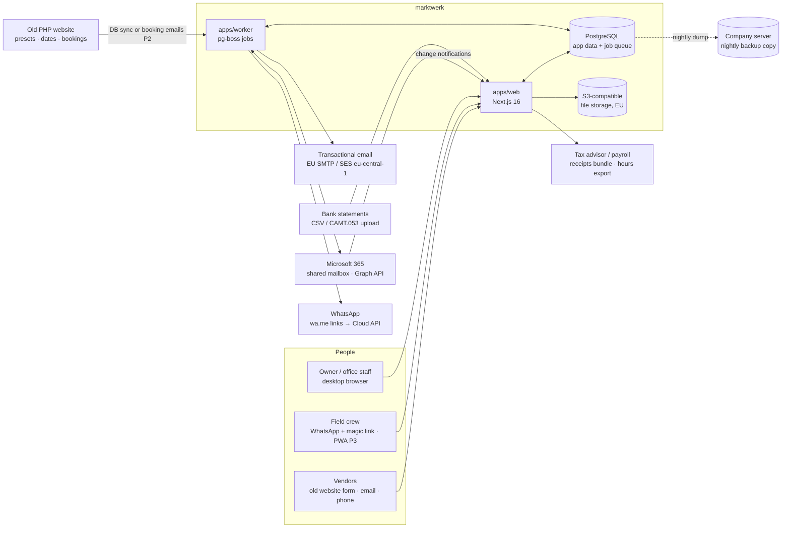

# Architecture overview

## System context



## Deployable units

| Unit | Tech | Responsibility |
|---|---|---|
| `apps/web` | Next.js 16 (App Router, React 19, Server Actions), Better Auth, next-intl, Tailwind 4 + shadcn/ui (Base UI) | Back office UI, staff magic-link pages, field PWA (P3), webhooks (Graph, WhatsApp), new public booking form (P4) |
| `apps/worker` | Node 22+/24, pg-boss 12 | Cron jobs (deadline sweep, nightly carry-over, digests, payroll reminders), async jobs (event generation, messages, PDFs, legacy-site/mailbox sync, bank import) |
| PostgreSQL | v18 in dev (Docker), managed or self-hosted in prod | Single source of truth incl. job queue (`pgboss` schema) |

Both units import the same internal packages, so domain rules exist exactly once.

## Code layout

```
marktwerk/
├── apps/
│   ├── web/                     Next.js app
│   │   ├── src/app/(auth)/      login (public)
│   │   ├── src/app/(app)/       back office (requires session)
│   │   ├── src/app/(staff)/     P1: magic-link pages for staff without login
│   │   ├── src/app/(field)/     P3: field PWA routes
│   │   ├── src/app/(public)/    P4: new booking form, vendor portal
│   │   ├── src/app/api/         auth, webhooks (Graph), file download
│   │   ├── src/server/          server-only: env, db, auth, session/permissions, services
│   │   ├── src/components/      ui/ (shadcn), shell/, feature components
│   │   ├── src/i18n/            next-intl config
│   │   └── messages/            de.json, en.json
│   └── worker/                  pg-boss process; src/jobs/*
├── packages/
│   ├── core/                    pure domain logic (no I/O): permissions, relative dates,
│   │                            reminders, holidays, pricing (P2), health computation
│   └── db/                      Drizzle schema, migrations (drizzle/), db client
└── docs/                        research, product, architecture, ADRs, development
```

**Layering rule:** UI (pages/components) → server actions/route handlers → **services**
(`apps/web/src/server/services/*`, transactional, audited, permission-checked) → db. Pure
calculations live in `packages/core` and are unit-tested. The worker calls the same services
and core functions, never duplicates them. When the worker needs a service, move it to a
shared `packages/services` package (planned in M2, once the first one exists).

## Cross-cutting concerns

| Concern | Approach |
|---|---|
| **AuthN** | Better Auth, email + password, sessions in Postgres, no self-signup; owner creates users (admin plugin). Staff without login: HMAC-signed magic links scoped to one staff member, revocable. Later: passkeys/2FA for owner. |
| **AuthZ** | `can(role, resource, action)` in `@marktwerk/core`; `requirePermission()` at the top of every page/action/handler; row-level scoping in queries (field users → only events with their shift/duty). |
| **Audit** | `audit_log` row in the same transaction for every business mutation (service layer helper). |
| **i18n** | next-intl; locale from user profile → cookie; messages in `apps/web/messages/{de,en}.json`; typed keys. Emails and PDFs use the recipient's locale (vendors default `de`). |
| **Time** | All instants UTC; market days as dates; company TZ `Europe/Berlin`; `resolveRelativeDue()` handles DST. |
| **Files** | Storage adapter (`local` in dev, S3-compatible EU bucket in prod); downloads only through an authorised route; virus scan optional later. |
| **Jobs** | pg-boss: cron + queues; idempotent handlers (dedupe keys); jobs carry IDs, not payload copies. |
| **Email out** | Nodemailer via SMTP (Mailpit in dev) for system mail; vendor-facing mail (confirmations) via Graph from the shared mailbox (P2); React Email templates; per-recipient locale. |
| **Staff messaging** | `outbound_message` queue with debounce + quiet hours; WhatsApp via wa.me links (step 1) then Cloud API (step 2), ADR 0011; signed magic links for staff pages. |
| **Legal parameters** | Minimum wage, Minijob limit, inspection intervals etc. in a dated `legal_parameter` table, never in code. |
| **Search** | Postgres full-text search (`tsvector`, German + simple configs) and `pg_trgm`; no external engine. |
| **Real-time** | Not in MVP. Revalidate on mutation; later SSE or Postgres LISTEN/NOTIFY for the inbox collision indicator (P2). |
| **Offline (P3)** | Serwist service worker for the shell + IndexedDB (Dexie) snapshot of the day sheet + an outbox of append-only commands with idempotency keys. No general offline editing. |
| **Observability** | Structured logs (pino) in both apps; Sentry (EU region) or GlitchTip self-hosted; uptime check. |
| **Security** | CSP headers, rate-limited auth, secrets in env only, dependency updates via Renovate, backups with tested restore (once hosted), GDPR deletion jobs. |

## Microsoft 365 mailbox integration (Phase 2)

Decisions from research 03, recorded as ADR 0008 (proposed):
- **Microsoft Graph only.** EWS is being blocked in Exchange Online since Oct 2026 and removed in Apr 2027.
- Entra ID app registration with **application permissions** `Mail.ReadWrite`, `Mail.Send`,
  **restricted to the shared mailbox(es) via Exchange RBAC for Applications**. No delegated tokens
  tied to an employee.
- Ingestion: **change notifications** (webhook → enqueue) plus a periodic **delta query** as a safety
  net, with subscription renewal and lifecycle-notification handling in the worker.
- **Mail stays in Exchange** (Outlook keeps working). marktwerk stores a copy of messages + metadata
  for search and linking. **Workflow state** (assignee, status, notes, links, snooze) lives only in marktwerk.
- Replies via Graph `sendMail` from the shared mailbox, so they appear in Sent Items.
- Threading by `conversationId`, plus `internetMessageId` / `In-Reply-To` as fallback.

## Environments

| Env | Where | Notes |
|---|---|---|
| local | Docker Compose: Postgres 18, Mailpit | `pnpm dev` runs web + worker |
| staging | Decided in ADR 0006 before M4 pilot | Seeded demo data, production-like |
| production | EU only | Backups (PITR) + **nightly encrypted copy to the company server**, restore test, monitoring, separate secrets |

## Hosting options (decision deferred, ADR 0006)

| Option | Pros | Cons |
|---|---|---|
| **A. Vercel (fra1) + Neon/Supabase Frankfurt + worker container (Hetzner/Fly fra)** | Least ops for web, preview deploys | 3 vendors, US parent companies, worker still needs a host |
| **B. Hetzner (DE) + Coolify/Docker Compose: web + worker + Postgres** | Cheapest, all in German jurisdiction, one place | We run backups, patching and monitoring ourselves |
| **C. Hetzner app servers + managed Postgres (e.g. Hetzner/Ionos/Neon EU)** | Middle ground | Two providers |

The app is built with `output: "standalone"` and a stateless web tier, so moving between options is cheap.
