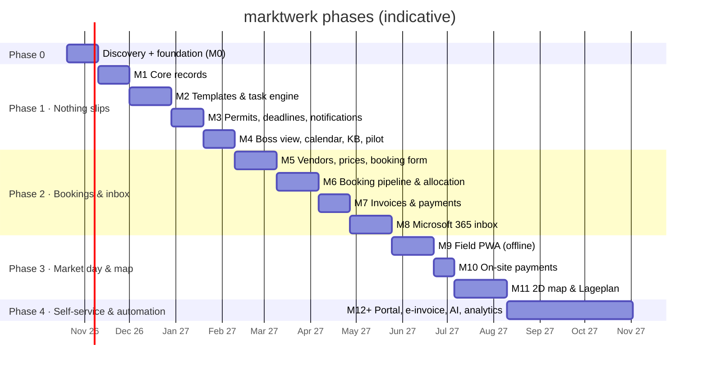

# Roadmap: MVP to full platform

Ordered by the client's pain (**tasks, checklists, deadlines first**). Each phase must be usable on
its own and replace a real spreadsheet or habit before the next phase starts. Durations assume one
developer + Claude and are rough. Re-plan after every phase.

---

## Phase 0: Discovery & foundation (≈ 3 weeks)

**Discovery with the client** (runs alongside M0; see [open-questions.md](../open-questions.md)):
- Shadow one full market day (05:00 to teardown) and one office day.
- Collect real artefacts: Excel sheets, paper checklists, permit PDFs, booking emails, price lists,
  Marktordnung, invoice samples, WhatsApp group habits.
- Write down the **real** checklist for one venue end to end (T-90 … T+7). It becomes the first template.
- Measure baselines for the success metrics in [vision.md](./vision.md).

**M0 Foundation**: *done in the initial setup*
- Monorepo (pnpm + Turborepo), Next.js 16 web app, worker (pg-boss), Postgres + Drizzle, Docker dev services
- Better Auth (email + password, no self-signup), roles `owner/manager/staff/field`, permission matrix in `@marktwerk/core`
- DE/EN i18n, app shell with module navigation, audit log table, settings table, seed script
- Exit: `pnpm dev` runs, login works, CI is green.

---

## Phase 1: "Nothing slips" MVP (≈ 3 months)

Goal: every recurring piece of work and every permit deadline is generated per market, assigned,
visible and escalated. Replaces the task spreadsheets, paper checklists and the permit folder.

### M1: Core records (≈ 3 weeks)
- **Users & duty roles**: owner invites staff (admin plugin), sets permission role; duty roles CRUD
- **Venues** with zones (capacity in metres), access info, custom fields, landowner contact, documents
- **Contacts** (authorities, landowners, suppliers)
- **Series & markets**: recurrence rule → **pick dates in a calendar → generate N markets** (preview first);
  single markets; market page with tabs (Overview · Tasks · Permits · Team · Documents · Notes)
- **Market anchors** and **duty assignment per market** (defaults from series)
- Files: upload/attach (local disk in dev, S3 adapter)
- *Inspiration:* Crescat (event types, metadata fields), VOIS|MARKT (dates from rhythm + season)
- Exit: all of next season's markets for one venue exist in marktwerk with correct dates and teams.

### M2: Templates & task engine (≈ 4 weeks)
- **Checklist templates** with draft → publish versions; items with phase, anchor, signed offset,
  calendar/business days, due time, duty role, priority, evidence (photo/note/attachment/sub-items),
  approval, dependencies, conditions
- **Instantiation** on market creation (one service path); **anchor change** → preview → recalc → one grouped notification
- **Apply template version to markets…** with preview and merge rules; **update template from this market**
- **Task views**: My tasks (Overdue / Today / Next 7 days / Later / No date), Market × phase board,
  team workload (people × weeks, counts not hours), unassigned queue; filters + saved views;
  keyboard shortcuts (`c` create, `a` assign, `/` search) and a command palette (`⌘K`)
- Task detail drawer: comments with @mentions, check items, attachments/photos, activity log
- Status `waiting_external` ("waiting for Ordnungsamt")
- Mobile-friendly *online* market-day checklist (the offline version is M9)
- *Inspiration:* Paperless Pipeline (named trigger dates), Process Street (versioned propagation,
  stop/approval tasks), Manifestly (roles per run), Linear (keyboard UX, triage), SafetyCulture (evidence logic)
- Exit: the real checklist from discovery runs for every market at the pilot venue.

### M3: Permits, deadlines & notifications (≈ 3 weeks)
- **Permit requirements per venue** (type, authority, cadence, lead/processing time, preparation template)
- **Permit vault**: instances, statuses, versions (supersedes), conditions (Auflagen) → tasks, documents,
  expiring/expired flags, coverage of markets (one §69 designation → many dates)
- **Deadline sweep** (worker, every 15 min), **escalation ladder**, escalation log
- **Notification center**: grouped per subject; Done / Save / Snooze (wakes on activity) / Unfollow; filters by reason
- **Email**: instant mails for assignment/mention/approval; **daily digest 07:00**; **owner weekly digest**
- Preferences per user × reason
- *Inspiration:* GitHub/Linear inbox, Asana inbox, Odoo escalation, SafetyCulture credential reminders (+ fixing their manager gap)
- Exit: every permit for the next 12 months is in the vault with an owner, and a test deadline
  produces the correct reminder → escalation chain.

### M4: Boss view, calendar, knowledge base, pilot (≈ 3 weeks)
- **Boss view**: next 14/30 days of markets as rows, computed health (permits · tasks · team), critical
  deadlines, overdue by person, unassigned queue, staleness; override with reason
- **Calendar** (month/week) of markets + permit deadlines; iCal feed per user (read-only)
- **Knowledge base**: Notion-style editor (TipTap), categories, venue pages link to articles, full-text search
- Global search (⌘K) across markets, venues, tasks, permits, contacts, articles
- **Pilot**: the whole team uses marktwerk for one block of markets; weekly feedback loop
- *Inspiration:* Asana portfolios + Linear project health (computed instead of manual), Notion/Outline
- Exit: success metrics measured against baseline; go/no-go for Phase 2.

---

## Phase 2: Bookings & inbox (≈ 3.5 months)

Goal: vendor bookings and the shared mailbox flow into one pipeline. Replaces the booking
spreadsheet, manual invoice writing and the "who answered this mail?" problem.

### M5: Vendors, price rules, booking form (≈ 4 weeks)
- **Vendor CRM**: private/commercial, categories, default length/depth, car + car length, power, documents
  with expiry, regular flag, history, **new vs returning + diff vs last application**, GDPR retention
- **Price rules**: €/m by category (Trödel/Neuware), min/max length, flat-up-to-X, volume breaks,
  add-ons with conditions (car only ≥ car length + 1 m, corner ≥ 6 m), tax code per line
- **Public booking form** (DE/EN, mobile-first, branded): market(s), length, car, add-ons, documents,
  terms acceptance; live price preview; anti-spam
- *Inspiration:* Hochberg/Melan booking flows, FestivalPro advance form, Marktmeister Pro diff view

### M6: Booking pipeline & allocation (≈ 4 weeks)
- Booking statuses as **separate layers** (booking / date / placement / finance / attendance)
- Review queue with bulk accept/waitlist/decline + reason templates; **category caps**; waitlist
- **Zones/rows with metre intervals**; **Scheduler matrix** (rows × dates) with pending counters
- **Regulars**: Stammplatz preferences, "apply regulars" with conflict list, opt-in/opt-out deadline
- Season bookings with **per-date absence override** (resell one date)
- Holds with expiry; status-change emails; arrival info mail (stall, time, map snippet)
- Occupancy feeds the boss view
- *Inspiration:* Marketspread Scheduler + double bookings, Manage My Market Matrix, ExpoFP holds, VOIS Branchenmix

### M7: Invoices & payments (≈ 3 weeks)
- GoBD invoicing: gap-free numbers, **draft → release**, immutable issued PDFs, Storno/credit notes,
  §4 Nr. 12 exemption notes / 19% lines, archive
- **EPC/GiroCode QR** + unique payment reference; manual "mark paid"; **CAMT.053 bank statement import**
  with automatic matching
- Dunning reminders; overdue → release placement (configurable)
- CSV / **DATEV Buchungsstapel** export (accounting integration decided later)
- *Inspiration:* Marketspread draft/release, lexoffice invoice UX

### M8: Microsoft 365 inbox (≈ 4 weeks)
- Graph API with app permissions scoped to the shared mailbox(es); webhooks + delta sync; mail stays in Exchange
- **3-pane triage**: list · thread with internal notes · context drawer (vendor detected by sender, bookings, quick actions)
- Assign / Open-Waiting-Closed / snooze / reply reopens; inbox-duty rotation; SLA warning
- **Convert email → booking draft / task / vendor note**; links to vendor/market/booking/permit/task
- Reply templates with variables (formal "Sie" default), send as shared mailbox
- *Inspiration:* Front (links, snooze, SLA, shared drafts), Missive, Linear triage

---

## Phase 3: Market day & map (≈ 2.5 months)

### M9: Field PWA, offline (≈ 4 weeks)
- Installable PWA, high-contrast "6 am mode", big touch targets
- **Day sheet** snapshot cached offline: address, gate code, contacts, rundown, stall list, permit PDFs
- Offline checklist with photo evidence (queued uploads, visible sync state per photo), append-only outbox
- Vendor check-in (list + search + QR), no-show release at configurable time, walk-up registration
- **Incident log** ("Vorfallbuch", append-only, photos, PDF export); explicit day close-out
- *Inspiration:* SafetyCulture offline, Connecteam, Master Tour day sheets, Marketspread Pass, Markttagmeister

### M10: On-site payments (≈ 2 weeks): **blocked on the tax/legal decision**
- Option A: cloud TSE (e.g. fiskaly) + e-receipts. Option B: card only via SumUp Cloud API, plus guided
  daily *Kassenbericht* for an open cash box. See [open-questions.md](../open-questions.md).

### M11: 2D map & Lageplan (≈ 5 weeks)
- Venue layout: background image/PDF (opacity), rows drawn as lines/rectangles with metre scale (react-konva)
- Layers: stalls by payment/category/power, infrastructure, escape routes/fire lanes
- Drag placements onto rows, copy layout to next date, collision/rule warnings
- **Lageplan export** (PDF, A3/A1) + quantity list + **view-only link for authorities**
- *Inspiration:* OnePlan, ExpoFP, Eventeny map editor, Seen Markets

---

## Phase 4: Self-service & automation (2027+)
- **Vendor portal** via magic link: bookings, documents (with expiry reminders), invoices, QR pass, change requests
- Vendor self-select of stalls on the map (mobile-friendly, holds with expiry)
- Optional online payments (Mollie/Stripe: SEPA, PayPal, cards, Wero)
- **E-Rechnung** (ZUGFeRD/XRechnung, EN 16931) for B2B. Mandatory for issuers > €800k turnover from 2027
  and for everyone from 2028, so it's needed **before 2028** at the latest.
- Accounting sync (Lexware Office / sevDesk) or deeper DATEV integration
- **AI assistance** (EU-hosted, AVV): classify incoming mail, extract booking requests into drafts, suggest replies
- Season analytics (occupancy, revenue per metre, no-show rate, vendor retention), crew shift claiming
- Weather alerts on market days; SMS for urgent vendor notices

## Always-on work (every milestone)
Tests for domain logic, audit logging, permission checks, DE/EN strings, accessibility basics,
backups once hosted, GDPR (data inventory, deletion jobs), docs updates.
