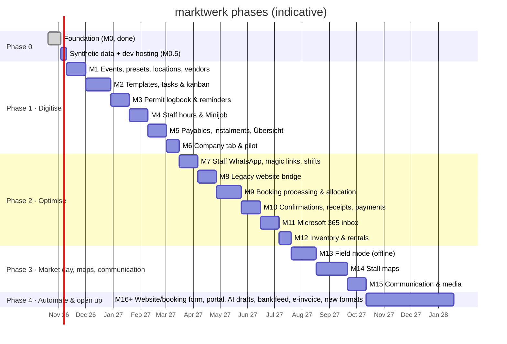

# Roadmap: MVP to full platform

**Revision 3.1 (2026-10-21)**, rebuilt after the client meeting ([research 05](../research/05-client-meeting-2026-10.md)),
the follow-up research ([06](../research/06-staff-whatsapp-shifts-kanban.md), [07](../research/07-inventory-finance-fleet.md),
[08](../research/08-bookings-comms-newsletter.md)) and the product owner's decisions of 2026-10-21.
*Rev. 3.1 (session 2):* classic screens instead of the customisable workspace (ADR 0019), the company-wide **Kalender**
module, start screen **Übersicht**.

**Order: digitise → optimise → automate.** Phase 1 only *digitises* how the company works today: it records,
shows and reminds. It doesn't change processes or message staff. **Scope: the current business**, i.e. flea markets
and antique markets, plus Stadtfeste and Food & Wine markets. New formats (design markets, workshops,
tournaments) come much later. Within Phase 1 the product owner set the order: core (events, templates, kanban,
permits) → **staff hours & Minijob** → **payables & instalments**. Durations assume one developer + Claude and are
rough; re-plan after every milestone.

---

## Phase 0: Foundation, synthetic data, discovery

**M0 Foundation: done.** Monorepo, Next.js 16 web app, pg-boss worker, Postgres + Drizzle, Better Auth with
roles, DE/EN, app shell, CI, GitHub `coelln-konzept/marktwerk`.

**M0.5 Synthetic data & development hosting (≈ 1 week)**
- `packages/synthetic`: deterministic, seeded generator for a realistic but fictional dataset (venues in the
  Cologne region, presets, a season of flea/antique/Stadtfest/Food & Wine events, templates, tasks, permits,
  staff & shifts, payables, vehicles, ~1,500 vendors, booking history). **All development uses it** until real
  data is available (ADR 0016). M1's seed script loads it.
- **Development hosting on free tiers** (ADR 0017): Vercel + Supabase (`marktwerk-dev`), scheduled jobs via GitHub
  Actions. Production host (Scalingo candidate, ADR 0006) is decided before the pilot.
  See [deployment.md](../development/deployment.md).

**Discovery (with the client, ongoing):**
1. **Timeline workshop:** "the market is on the 1st; what happens 1 week, 2 weeks, 2 months, 6 months before,
   and after?" One session each for flea, antique, Stadtfest, Food & Wine. Capture **time estimates**.
2. **Permit inventory** per location (city vs. external), lead times, application windows, fees/instalments, stickers.
3. **Old website access** (later; until then synthetic data): copy into a sandbox, never touch production.
4. **Staff list** (contract types, rates, contracted hours) and what the payroll office needs by the 15th.
5. **Payables list** (location fees, instalments), recurring company costs, vehicles.
6. Shadow one market day and one office day; collect the paper stall maps.

---

## Phase 1: Digitise (MVP, ≈ 4.5 months)

Goal: everything the office keeps in heads, documents and paper today lives in marktwerk: events, timelines,
tasks, permits, hours, payments due, company duties. Reminders go to **office users in-app and by email**; the
office tracks field crew tasks and hours on their behalf (staff messaging comes in Phase 2).

### M1: Events, presets, locations, vendors (≈ 3 weeks)
- **App shell** (ADR 0019, [UX concept v2](./ux-concept.md)): sidebar, top bar with search/Strg+K + Neu + notifications,
  pages with Vorschau and detail drawers, event tabs, theme (light/dark/system) and density switch, design tokens +
  base components from the Claude Design output ([`docs/design/claude-design/a-classic/`](../design/claude-design/a-classic/INDEX.md))
- **Übersicht** (start screen, `/`): KPI strip and Dieses Wochenende from events; Heute fällig and the season strip
  fill up as M2–M5 add tasks, permits, hours and payables
- **Kalender** module (`/kalender`): month view with KW + "Liste · 6 Wochen", layer panel saved per person; M1 ships the
  **events + NRW holidays** layers, the other layers arrive with their modules (tasks M2, permits M3, hours/shifts M4,
  instalments M5, vehicles & obligations M6, rental returns M12)
- **Event types** (data, extensible): **Flohmarkt, Antikmarkt, Stadtfest, Food & Wine**, with rules (new-goods
  share, banned goods, online booking allowed, default price/m, booking fee)
- **Event presets** (the old website's "presets", extended): type + location + public texts + price + templates
  + permit needs + default team + optional recurrence. **Generate events from a preset** (pick dates → preview → create)
- **Events** with lifecycle `planned (announced, permit pending; start state) → confirmed (automatic when all permits granted) → live → completed → closed`
  (+ `cancelled`; UI: Entwurf · geplant · bestätigt · läuft · abgeschlossen · abgesagt, "abgerechnet" from M10)
  and separate booking flags (bookable, fully booked, car spaces sold out); multi-day events (Stadtfest)
- **Locations** with zones/rows (metres), access info, custom fields; **contacts** (authorities, landowners,
  suppliers incl. the stall supplier); **multi-year location agreements** (fixed dates → events)
- **Staff members** (with or without login), duty roles, default people per preset; users & permission roles
- **Vendor list (read-only import)** from the synthetic dataset now, real export later (decision 2026-10-21)
- Event page with tabs: Überblick · Board · Genehmigungen · Team · Geld · Dokumente · Notizen · Verlauf (counts/health per tab)
- *Inspiration:* their own PHP admin (preset → date), Crescat event types, VOIS|MARKT (dates from rhythm)
- **Exit:** a full season of (synthetic, later real) events exists with correct dates, types and teams.

### M2: Templates, tasks & kanban (≈ 4 weeks)
- **Timeline templates** per event type/preset: phase, anchor + signed offset (T-180 … T+7), business/calendar
  days (NRW holidays), duty role, priority, **time estimate**, evidence, dependencies, categories incl.
  **communication** (website listing, posters & stickers, flyers, social, newsletter)
- Versioned templates; **publishing never touches existing events**. Applying a version to events is a separate,
  **deliberate editor action** with nothing pre-selected and a preview (decision 2026-10-21)
- Instantiation on event creation (one service path); anchor change → preview → recalc → grouped notice
- **Kanban board per event** (Vorbereitung · Diese Woche · Heute · Erledigt) + **people rail**: drop a card on a
  person to assign (undo toast); swimlanes by person; **load bars** (estimated hours vs. capacity)
- **Carry-over:** overdue unfinished tasks roll into "Heute" with ↻n; flagged to the manager after 3
- **Task detail drawer** (description, check items, evidence, activity, status incl. "Wartet · Amt"; comments were dropped and snooze added on 2026-10-22)
- My tasks, cross-event board, unassigned queue, keyboard shortcuts, Strg+K; Kalender layer *Aufgaben*
- **Workload & hiring view:** board "Arbeitslast" toggle (estimated hours per person/week), hours per event and per
  season; the **season strip** on Übersicht with the hiring signal ("≈ x Minijobber/Monat zusätzlich")
- *Inspiration:* Linear swimlanes, Asana workload, Sunsama rollover, Paperless Pipeline anchors, Process Street versions
- **Exit:** the workshop timelines run for every upcoming event; the boss sees hours per event.

### M3: Permit logbook & reminders (≈ 3 weeks)
- **Company logbook ("Status quo"):** all permits/OKs by location and category (**city**: market permit, water,
  signage/posters with stickers, no-parking; **external**: toilets, landowner OK…), validity, documents, fees
- Requirements per location/type with lead times (2–6 months), **application windows**, **expected decision dates**
  (e.g. Altstadt: city decides in January); coverage (one permit → many events)
- **Creating an event auto-fills the logbook:** covered items ticked with document links; missing ones become
  tasks by urgency; conditions (Auflagen) → tasks; sticker counts
- **Deadline sweep** + escalation **to the manager**; notification center; email + daily digest (office users)
- **Exit:** every permit for next season is in the logbook with owner and deadline.

### M4: Staff hours & Minijob (≈ 3 weeks)
- Contracts (type, dated hourly rate, **contracted hours**, fixed pay/working-time account, declared other Minijobs)
- **Legal parameters table** (2026: €13.90 / €603; 2027: €14.60 / €633)
- **Shift records** per event entered **by the office** (from today's paper/WhatsApp info): planned/actual times,
  breaks; **§17 MiLoG** day-5 alert / day-7 deadline; versioned changes with reason; kept ≥ 2 years
- **Team page:** hours & pay this month, **remaining allowance**, YTD, overrun months; amber/red warnings
  (`minijobMonthStatus` in `@marktwerk/core`); ArbZG warnings for heavy weekends
- **Month close:** lock → approve → **CSV export** (DATEV LODAS once agreed) → reminder 12th, deadline 15th
- **Exit:** the monthly hours document is retired.

### M5: Payables, instalments & the complete Übersicht (≈ 3 weeks)
- **Payables** with **instalment plans**, reminders (14 d / 3 d / due / overdue), mark paid (= the expense),
  linked from tasks/permits (single entry)
- **Receipts** (photo/PDF) on payables/expenses; "missing receipt" counter; monthly bundle for the tax advisor
- **Event money tab:** costs by category, plan → committed → actual (revenue from bookings in Phase 2)
- **Übersicht complete:** ranked **"Heute fällig"** (tasks, permits, instalments, missing hours) with filter chips
  incl. **Geld**; KPI "Geld überfällig"; event health; Dieses Wochenende with all health columns
- **Exit:** no instalment is paid late; the owner opens Übersicht instead of asking.

### M6: Company tab & pilot (≈ 2 weeks)
- Recurring **obligations** (date and/or km): vehicles (HU 24/12 months, **UVV yearly**, service, insurance, tax),
  insurance renewals, KSK report (31 March); vehicle defect reports with photo
- **Production hosting** set up (Scalingo candidate) and **pilot** with the office team for one block of events (real data entered by them); weekly feedback
- **Exit:** go/no-go for Phase 2; success metrics measured.

---

## Phase 2: Optimise (≈ 4 months)

With everything digital, improve the processes: reach field staff directly, and process bookings inside
marktwerk while vendors still see the old website, email and phone.

### M7: Staff WhatsApp, magic links, shift planning (≈ 3 weeks)
- **Staff page via magic link** (no login): my tasks (Zusagen / Erledigt / Kann nicht), my shifts, my hours,
  entering own actual times
- **WhatsApp step 1:** assignments and shift requests create ready messages; **"Per WhatsApp senden"** opens
  wa.me with text + magic link from the office phone (€0); debounced; quiet hours; opt-in records.
  Step 2 (Cloud API, quick-reply buttons) in M15 or earlier if needed (ADR 0011)
- **Shift planning per event:** roles → people (same people, same roles), suggestions ranked by remaining
  Minijob allowance; request/confirm by deadline (Deputy pattern)

### M8: Legacy website bridge (≈ 3 weeks)
- Preferred: read-only access to (a copy of) the PHP site's database, syncing bookings, presets, dates, vendors.
  Fallback: **deterministic parsing of the website's booking emails** (fixed rules, Message-ID idempotency, alert
  on parse failure); Graph subscription on the booking mailbox (ADR 0008/0013)
- Import vendors + newsletter list (with consent status), past bookings for history
- Keep website dates in sync manually at first; marktwerk becomes the source of truth in Phase 4

### M9: Booking processing & allocation (≈ 4 weeks)
- **Per-event booking queue**: multi-date requests **split into one request per event**
- Vendor CRM (history, regular flag, notes incl. **vendor talks**, documents, "first event free" incentive),
  new vs. returning + diff vs. last booking
- **Phone entry screen** (keyboard-first, vendor lookup, per-date rows, 30 seconds)
- Allocation: rows with metre intervals and slot lists (derived from today's stall maps); **drag request onto
  slot**; **Autoplatz per date** (requested → granted/declined; car length ≤ booked length) + **"car spaces sold
  out"** switch; cut-off Monday; food vendors via yearly contracts; type rules (new-goods share)
- Status layers: booking · per-date · placement · payment · attendance (research 02)
- *Inspiration:* Marketspread scheduler, Eventeny per-date approval, Ebersberg car-length rule

### M10: Confirmations, receipts & payments (≈ 3 weeks)
- **Confirmation email + Platzkarte PDF** from per-event templates (replacing Outlook signatures), sent via
  Graph from the shared mailbox; **states per date whether a car space is granted**
- Platzkarte designed as a valid **Kleinbetragsrechnung** (≤ €250, "steuerfrei gem. §4 Nr. 12a UStG");
  **full invoice on request with a separate recipient name** (sequential number, immutable, Storno); GiroCode QR
- **Payment check session** (Mon/Wed/Fri): upload bank CSV/CAMT.053 → suggested matches by reference/amount/name →
  batch confirm; partial payments; optional "Zahlung erhalten" email
- Unpaid after deadline → **reminder drafts a person sends**; cancellation with notice only after that
- Event P&L gets the revenue side; close-out wizard
- ⚖️ Confirm with the tax advisor: VAT status of food/festival stalls, the €2.50 fee, §9 option

### M11: Microsoft 365 inbox (≈ 3 weeks)
- Graph app permissions scoped to the booking mailbox; webhooks + delta; mail stays in Outlook
- Thread → per-event queue; link to vendor/booking/task; convert to booking draft or task; reply templates
  with event variables; assign, snooze, reopen on reply
- Free-text requests stay human; AI drafting is Phase 4

### M12: Inventory & rentals (≈ 2 weeks)
- Bulk item types (cables, power boxes, tables, standpipes…), quantities, out-of-service count
- Requirements per preset → per event; availability over setup/teardown windows; **shortage list per weekend**
- **"Solve shortage → rent"**: rentals with supplier, return-by date, deposit, late fee, meter readings;
  reminders to the responsible person + manager; packing list printout; missing/defect → task
- *Inspiration:* Rentman shortages & sub-rentals, Cheqroom overdue check-outs. **No barcodes/RFID.**

---

## Phase 3: Market day, maps, communication (≈ 3 months)

### M13: Field mode, offline (≈ 4 weeks)
- PWA for field leads (staff without login keep WhatsApp + magic link): day sheet (address, gate, contacts,
  timeline, stall list, permit PDFs, packing list) cached offline; checklist with photo evidence; outbox sync
- Check-in, no-show release, walk-ups; **vendor talk notes** (quick capture → CRM); incident log
- On-site payments per ADR 0009 (⚖️ cash/KassenSichV decision first)

### M14: Stall maps (≈ 5 weeks)
- Today's paper maps become venue layouts: background image, rows/slots with metres, layers
  (stalls, car spaces, water/power, escape routes); drag bookings onto the map; copy layout to next date
- Exports: printable map for the crew, Lageplan for authorities (view-only link)

### M15: Communication & media (≈ 3 weeks)
- Per-event communication checklist (from templates) with channel status: website, newsletter, social posts
  (T-4w, T-1w, T-1d, day), flyers/posters (print deadlines, poster permits with stickers; Cologne: commercial placement)
- **Photo library**: per-event upload link for staff phones (no app), tagged by event/date, consent flag
- **Newsletter** moved off Outlook (Exchange now caps external recipients at 2,000/day) to an EU tool
  (Brevo/CleverReach/rapidmail) with contact sync and unsubscribe handling; soft opt-in notice added to forms
  (§7(3) UWG); vendors and visitors as separate lists
- **WhatsApp step 2:** Cloud API with utility templates and quick-reply buttons (≈ €15/month)

---

## Phase 4: Automate & open up (2027+)
- **New website + booking form** (with the corporate-design project), fed by marktwerk (event status planned/
  bookable/full, texts from presets); per-date metres + low-key car option ("auf Anfrage") + "copy previous date";
  invoice-recipient fields; soft opt-in notice
- Vendor self-service (magic link): bookings, Platzkarte/invoices, documents
- **AI drafting** (EU-hosted, opt-in): free-text email → draft booking in the right event queue; original
  side by side, found/guessed/missing fields, code validation, human confirms, corrections logged
- Bank feed (finAPI/Enable Banking/FinTS; not GoCardless), e-invoice issuing (ZUGFeRD/XRechnung) before 2028,
  accounting integration if the tax advisor wants it
- **New formats** (only now): design markets as their own type, workshops, tournaments with team registration & fees
- Analytics: vendor mix per event (antique vs. design), revenue/cost per event type, hours per event, retention
- Sister-company listings on the website

## Always-on work
Tests for domain rules, audit log, permission checks, DE/EN strings, backups (cloud + **local copy on the
company server**), GDPR (records of processing, retention: 8 years for receipts/invoices, 2 years for time records),
docs/ADRs.
