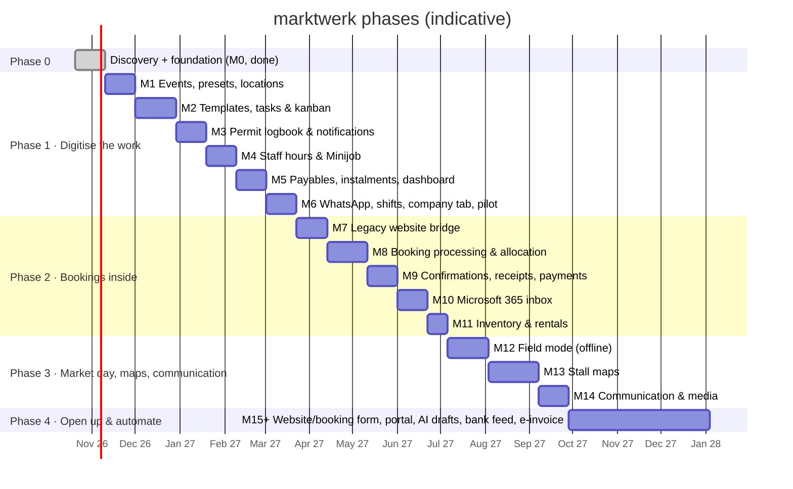

# Roadmap: MVP to full platform

**Revision 2 (2026-10-21)**, rebuilt after the client meeting ([research 05](../research/05-client-meeting-2026-10.md))
and the follow-up research ([06](../research/06-staff-whatsapp-shifts-kanban.md), [07](../research/07-inventory-finance-fleet.md),
[08](../research/08-bookings-comms-newsletter.md)).

Guiding order from the client: **digitise → optimise → automate**, **internal before external**.
Within Phase 1 the product owner set the order: core (events, templates, kanban, permits) → **staff hours &
Minijob** → **payables & instalments** → WhatsApp & shifts. Durations assume one developer + Claude and are rough;
re-plan after every milestone.

---

## Phase 0: Discovery & foundation

**M0 Foundation: done.** Monorepo, Next.js 16 web app, pg-boss worker, Postgres + Drizzle, Better Auth with
roles, DE/EN, app shell, CI.

**Discovery (with the client, next weeks):**
1. **Timeline workshop:** "the market is on the 1st; what happens 1 week, 2 weeks, 2 months, 6 months before,
   and after?" One session per event type (flea, antique/design, food & wine). Capture **time estimates**.
   This becomes the first templates.
2. **Permit inventory:** every permit/OK per location (city vs. external), lead times, application windows
   (e.g. the contested riverside location: city decides in January), fees and instalments, stickers.
3. **Old website:** get admin + server/DB access, **copy it into a sandbox, never touch production**;
   extract presets, dates, bookings, vendor/newsletter lists.
4. **Staff list:** contract types, hourly rates, contracted hours (§12 TzBfG trap), WhatsApp opt-in; ask the
   payroll office/tax advisor what exactly is due on the 15th and in which format.
5. **Payables list:** location fees, instalment plans, recurring company costs; vehicles (weights, HU dates).
6. Shadow one market day (incl. the vendor talks) and one office day; collect stall maps.

---

## Phase 1: Digitise the work (MVP, ≈ 4.5 months)

Goal: every recurring piece of work, permit, hour and payment obligation is in marktwerk, assigned and
reminded. Replaces task lists in heads, the permit folder, the hours document and forgotten instalments.

### M1: Events, presets, locations (≈ 3 weeks)
- **Event types** with rules (new-goods share, banned goods, online booking allowed, default price/m)
- **Event presets** (the old website's "presets", extended): type + location + public texts + price + templates
  + permit needs + default team + optional recurrence. **Generate events from a preset** (pick dates → preview → create)
- **Events** with lifecycle `draft → planned (announced, permit pending) → confirmed → live → completed → closed`
  and separate booking flags (bookable, fully booked, car spaces sold out); multi-day events
- **Locations** (venues) with zones/rows (metres), access info, custom fields; **contacts** (authorities,
  landowners, suppliers incl. the stall supplier)
- **Multi-year location agreements** (fixed dates for N years → generate events)
- **Staff members** (with or without login), duty roles, default people per preset; users & permission roles
- Event page with tabs: Overview · Board · Permits · Team · Money · Documents · Notes
- *Inspiration:* their own PHP admin (preset → date), Crescat event types, VOIS|MARKT (dates from rhythm)
- **Exit:** next season's events for all locations exist with correct dates, types and teams.

### M2: Templates, tasks & kanban (≈ 4 weeks)
- **Timeline templates** per event type/preset: phase, anchor + signed offset (T-180 … T+7), business/calendar
  days (NRW holidays), duty role, priority, **time estimate**, evidence, dependencies, conditions;
  categories incl. **communication** (website listing, posters, flyers, social, newsletter)
- Versioned templates; **publishing never touches existing events**. Applying a new version to events is a
  separate, **deliberate action by the editor**, with nothing pre-selected and a preview (decision 2026-10-21)
- Instantiation on event creation (one service path); anchor change → preview → recalc → grouped notice
- **Kanban board per event** (Vorbereitung · Diese Woche · Heute · Erledigt) + **people rail**: drop a card on a
  person to assign (undo toast); optional swimlanes by person; **load bars** (estimated hours vs. capacity)
- **Carry-over:** overdue unfinished tasks roll into "Heute" with a ↻ counter; flagged to the manager after 3 rollovers
- My tasks (Overdue / Today / 7 days / Later), cross-event board, unassigned queue, keyboard shortcuts, ⌘K
- **Workload & hiring view:** estimated hours per event, per person/week, per season; "≈ x Minijob-months"
- Quick feedback on completion (as planned / longer / shorter) to calibrate estimates; no timers
- *Inspiration:* Linear swimlanes & keyboard UX, Asana workload, Sunsama rollover, Paperless Pipeline anchors, Process Street versions
- **Exit:** the workshop timelines run for every upcoming event; the boss sees hours per event.

### M3: Permit logbook & notifications (≈ 3 weeks)
- **Company logbook ("Status quo"):** all permits/OKs by location and category (**city**: market permit, water,
  signage/posters with stickers, no-parking; **external**: toilets, landowner OK, …), validity, documents, fees
- Permit requirements per location/preset with lead times (2–6 months), **application windows** and **expected
  decision dates**; coverage (one permit → many events)
- **Creating an event auto-fills the logbook:** covered items are ticked with links to the documents; missing ones
  become tasks prioritised by lead time
- Conditions (Auflagen) → tasks; physical deliverables (sticker count received/used)
- **Deadline sweep** + escalation **to the manager** (only, for now); notification center (grouped, snooze, done);
  email for office users; daily digest 07:00
- *Inspiration:* SafetyCulture/Connecteam expiry reminders (+ manager escalation), Odoo escalation log
- **Exit:** every permit for next season is in the logbook with owner and deadline.

### M4: Staff hours & Minijob (≈ 3 weeks)
- Staff contracts: type (Minijob/Midijob/Werkstudent/full-time), hourly rate (dated), **contracted hours**,
  fixed monthly pay / working-time account, preferred duty roles, declared other Minijobs
- **Legal parameters table** (dated): minimum wage, Minijob limit (2026: €13.90 / €603; 2027: €14.60 / €633)
- **Shift records** per event (planned/actual start, end, break), entered by the lead or by the staff member
  via magic link; **§17 MiLoG**: alert on day 5, deadline day 7, versioned changes with reason, keep ≥ 2 years
- **Team page:** hours & pay this month (worked + planned), **remaining allowance in hours**, year-to-date vs.
  €7,236, overrun months in rolling 12; amber/red warnings (incl. €1,206 ceiling, 3rd overrun month)
- ArbZG warnings (10 h/day, 11 h rest, breaks, 15 free Sundays) for heavy weekends
- **Month close:** lock ~10th → approve → **CSV export** (+ DATEV LODAS ASCII once wage types are agreed with
  the tax advisor) → reminder 12th, deadline 15th
- *Inspiration:* Shiftbase Minijob contract type, Papershift, Crewmeister DATEV import
- **Exit:** the monthly hours document is retired.

### M5: Payables, instalments & the priority dashboard (≈ 3 weeks)
- **Payables** (location fees, permit fees, rentals, company costs) with **instalment plans** (generator: total ÷ n
  every m months, or free rows), due-date reminders (14 d / 3 d / due / overdue), mark paid (= the expense)
- Linked from tasks/permits (a "pay permit fee" task links to its payable; single entry)
- **Receipts:** photo/PDF upload on a payable or ad-hoc expense; "missing receipt" counter; monthly export bundle
  for the tax advisor (PDFs named by date/supplier/amount/event, CSV index; DATEV Upload Mail if they use DUo)
- **Event money tab:** costs by category, **plan → committed → actual**; revenue side comes with bookings (M9)
- **Owner dashboard:** ranked **"Heute fällig"** list (tasks, permits, instalments, rentals) with priority and a
  **finance filter**; event health (permits · tasks · team · money); upcoming weekend overview
- *Inspiration:* Lexware "Offene Posten" (+ instalments, which none of the tools have), Rentman financial tab, Eventtia "committed" column
- **Exit:** no instalment is paid late; the owner opens the dashboard instead of asking.

### M6: WhatsApp, shifts, company tab, pilot (≈ 3 weeks)
- **Staff page via magic link** (no login): my tasks (Zusagen / Erledigt / Kann nicht), my shifts, my hours this month
- **WhatsApp step 1:** assigning (drag) or shift requests create a ready message; **"Per WhatsApp senden"** opens
  wa.me with prefilled text + magic link from the office phone (€0, no Meta setup); debounced; quiet hours
- **Shift planning per event:** roles → people (defaults: same people, same roles), suggestions ranked by
  remaining Minijob allowance; request/confirm by deadline (Deputy pattern)
- **Company tab:** recurring **obligations** engine (date and/or km): vehicles (HU 24/12 months, **UVV yearly**,
  service, insurance, tax), insurance renewals, KSK report (31 March), driver issue reports with photo
- **Pilot:** whole team on marktwerk for one block of events; weekly feedback
- *Inspiration:* Deputy confirm-by-deadline, Fleetio due-soon thresholds
- **Exit:** go/no-go for Phase 2; measure the success metrics.

*WhatsApp step 2 (Cloud API with templates, quick-reply buttons, delivery ticks) is scheduled for M14, or earlier
if the wa.me step proves too manual. See ADR 0011.*

---

## Phase 2: Bookings inside (≈ 3.5 months), external side unchanged

Vendors keep using the old website, email and phone. marktwerk takes over the **internal** processing.

### M7: Legacy website bridge (≈ 3 weeks)
- Preferred: read-only access to (a copy of) the PHP site's database, syncing bookings, presets, dates, vendors.
  Fallback: **deterministic parsing of the website's booking emails** (fixed rules, Message-ID idempotency, alert
  on parse failure); Graph subscription on the booking mailbox (ADR 0008/0013)
- Import vendors + newsletter list (with consent status), past bookings for history
- Keep website dates in sync manually at first; marktwerk becomes the source of truth in Phase 4

### M8: Booking processing & allocation (≈ 4 weeks)
- **Per-event booking queue**: multi-date requests **split into one request per event**
- Vendor CRM (history, regular flag, notes incl. **vendor talks**, documents, "first event free" incentive),
  new vs. returning + diff vs. last booking
- **Phone entry screen** (keyboard-first, vendor lookup, per-date rows, 30 seconds)
- Allocation: rows with metre intervals and slot lists (derived from today's stall maps); **drag request onto
  slot**; **Autoplatz per date** (requested → granted/declined; car length ≤ booked length) + **"car spaces sold
  out"** switch; cut-off Monday; food vendors via yearly contracts; type rules (new-goods share)
- Status layers: booking · per-date · placement · payment · attendance (research 02)
- *Inspiration:* Marketspread scheduler, Eventeny per-date approval, Ebersberg car-length rule

### M9: Confirmations, receipts & payments (≈ 3 weeks)
- **Confirmation email + Platzkarte PDF** from per-event templates (replacing Outlook signatures), sent via
  Graph from the shared mailbox; **states per date whether a car space is granted**
- Platzkarte designed as a valid **Kleinbetragsrechnung** (≤ €250, "steuerfrei gem. §4 Nr. 12a UStG");
  **full invoice on request with a separate recipient name** (sequential number, immutable, Storno); GiroCode QR
- **Payment check session** (Mon/Wed/Fri): upload bank CSV/CAMT.053 → suggested matches by reference/amount/name →
  batch confirm; partial payments; optional "Zahlung erhalten" email
- Unpaid after deadline → **reminder drafts a person sends**; cancellation with notice only after that
- Event P&L gets the revenue side; close-out wizard
- ⚖️ Confirm with the tax advisor: VAT status of food/festival stalls, the €2.50 fee, §9 option

### M10: Microsoft 365 inbox (≈ 3 weeks)
- Graph app permissions scoped to the booking mailbox; webhooks + delta; mail stays in Outlook
- Thread → per-event queue; link to vendor/booking/task; convert to booking draft or task; reply templates
  with event variables; assign, snooze, reopen on reply
- Free-text requests stay human; AI drafting is Phase 4

### M11: Inventory & rentals (≈ 2 weeks)
- Bulk item types (cables, power boxes, tables, standpipes…), quantities, out-of-service count
- Requirements per preset → per event; availability over setup/teardown windows; **shortage list per weekend**
- **"Solve shortage → rent"**: rentals with supplier, return-by date, deposit, late fee, meter readings;
  reminders to the responsible person + manager; packing list printout; missing/defect → task
- *Inspiration:* Rentman shortages & sub-rentals, Cheqroom overdue check-outs. **No barcodes/RFID.**

---

## Phase 3: Market day, maps, communication (≈ 3 months)

### M12: Field mode, offline (≈ 4 weeks)
- PWA for field leads (staff without login keep WhatsApp + magic link): day sheet (address, gate, contacts,
  timeline, stall list, permit PDFs, packing list) cached offline; checklist with photo evidence; outbox sync
- Check-in, no-show release, walk-ups; **vendor talk notes** (quick capture → CRM); incident log
- On-site payments per ADR 0009 (⚖️ cash/KassenSichV decision first)

### M13: Stall maps (≈ 5 weeks)
- Today's paper maps become venue layouts: background image, rows/slots with metres, layers
  (stalls, car spaces, water/power, escape routes); drag bookings onto the map; copy layout to next date
- Exports: printable map for the crew, Lageplan for authorities (view-only link)

### M14: Communication & media (≈ 3 weeks)
- Per-event communication checklist (from templates) with channel status: website, newsletter, social posts
  (T-4w, T-1w, T-1d, day), flyers/posters (print deadlines, poster permits with stickers; Cologne: commercial placement)
- **Photo library**: per-event upload link for staff phones (no app), tagged by event/date, consent flag
- **Newsletter** moved off Outlook (Exchange now caps external recipients at 2,000/day) to an EU tool
  (Brevo/CleverReach/rapidmail) with contact sync and unsubscribe handling; soft opt-in notice added to forms
  (§7(3) UWG); vendors and visitors as separate lists
- **WhatsApp step 2:** Cloud API with utility templates and quick-reply buttons (≈ €15/month)

---

## Phase 4: Open up & automate (2027+)
- **New website + booking form** (with the corporate-design project), fed by marktwerk (event status planned/
  bookable/full, texts from presets); per-date metres + low-key car option ("auf Anfrage") + "copy previous date";
  invoice-recipient fields; soft opt-in notice
- Vendor self-service (magic link): bookings, Platzkarte/invoices, documents
- **AI drafting** (EU-hosted, opt-in): free-text email → draft booking in the right event queue; original
  side by side, found/guessed/missing fields, code validation, human confirms, corrections logged
- Bank feed (finAPI/Enable Banking/FinTS; not GoCardless), e-invoice issuing (ZUGFeRD/XRechnung) before 2028,
  accounting integration if the tax advisor wants it
- New formats: team registration & fees (e.g. volleyball tournament), workshops with tickets
- Analytics: vendor mix per event (antique vs. design), revenue/cost per event type, hours per event, retention
- Sister-company listings on the website

## Always-on work
Tests for domain rules, audit log, permission checks, DE/EN strings, backups (cloud + **local copy on the
company server**), GDPR (records of processing, retention: 8 years for receipts/invoices, 2 years for time records),
docs/ADRs.
