# User flows

Mermaid diagrams (render on GitHub). Phase markers: **P1** MVP, **P2** bookings inside, **P3** market day,
maps, communication, **P4** open up. Revised 2026-10-21 after the client meeting.

## 1. Event lifecycle (P1)

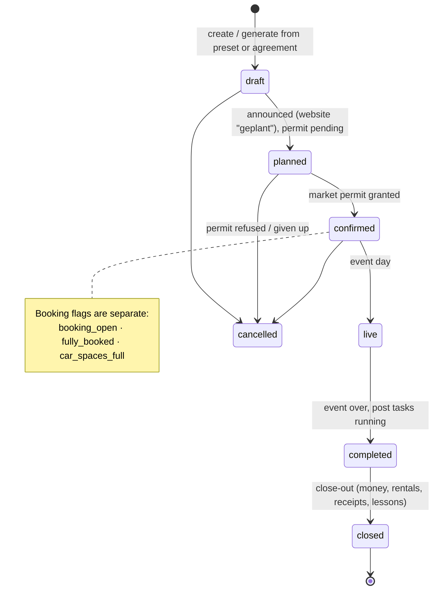

## 2. Creating an event: the logbook fills itself (P1)

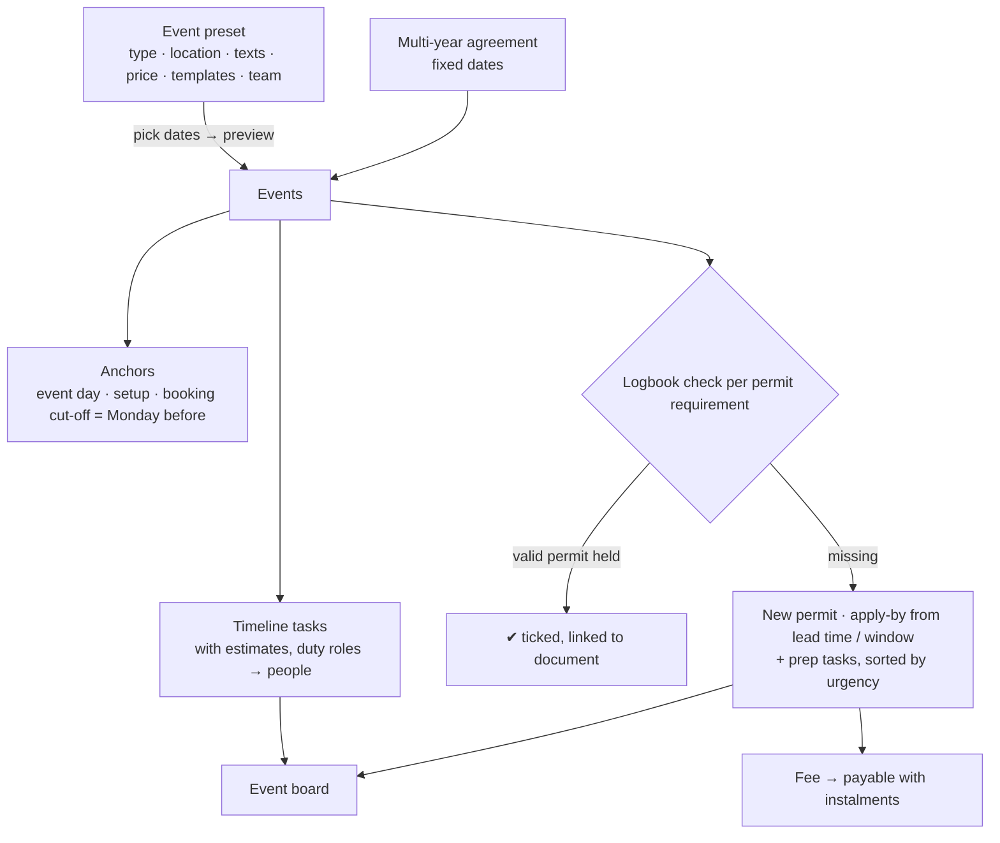

## 3. Kanban: assign by drag (P1); WhatsApp notification (P2, M7)

In Phase 1 the drop assigns the task and notifies office users in-app/by email; field crew tasks are
tracked by the office. The WhatsApp part below starts in Phase 2.

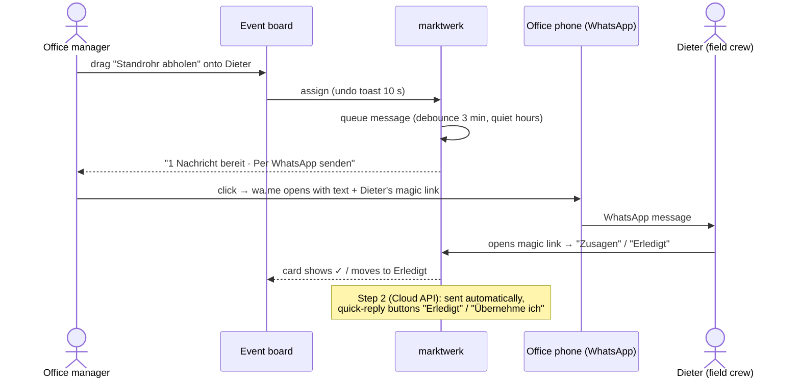

## 4. Moving an event date (P1)

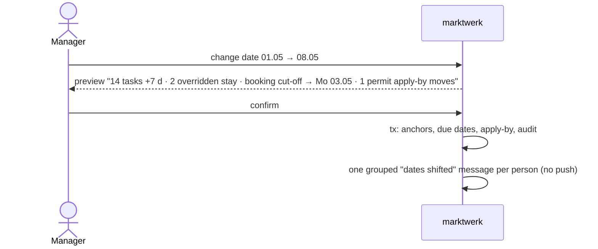

## 5. Template change (P1): always deliberate

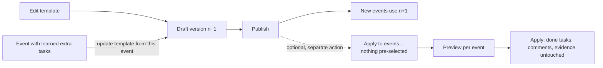

## 6. Deadlines, carry-over, escalation (P1)

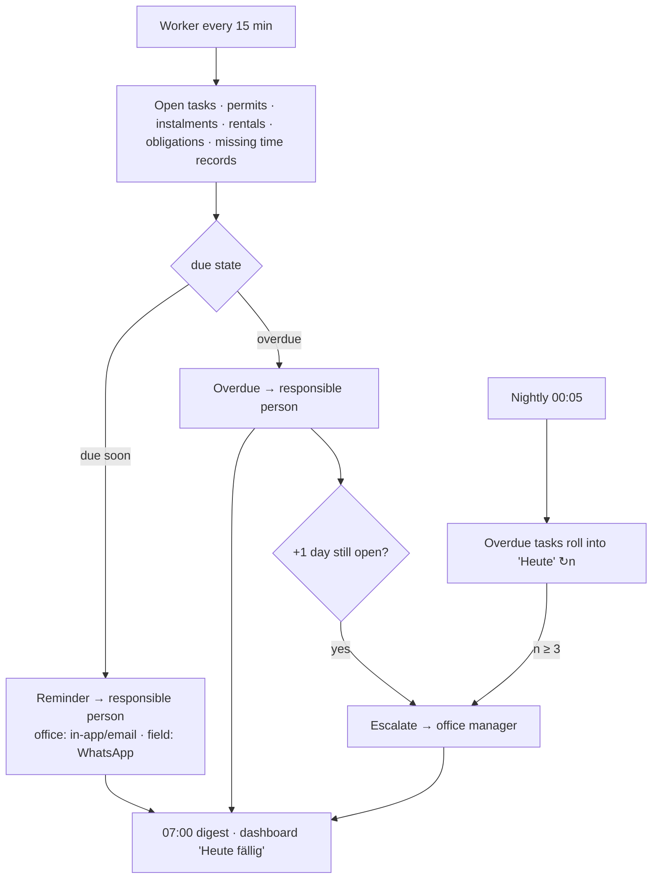

## 7. Staff hours & Minijob month (P1)

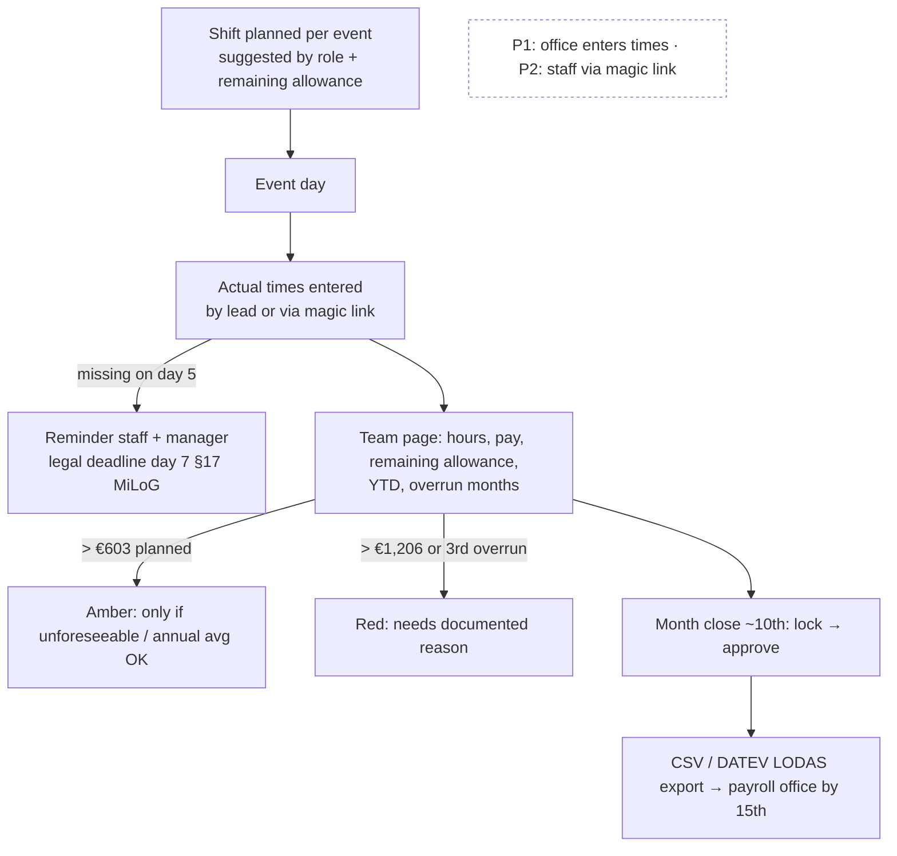

## 8. Payables with instalments (P1)

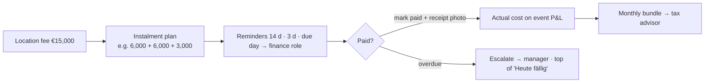

## 9. Booking intake while the old website stays (P2)

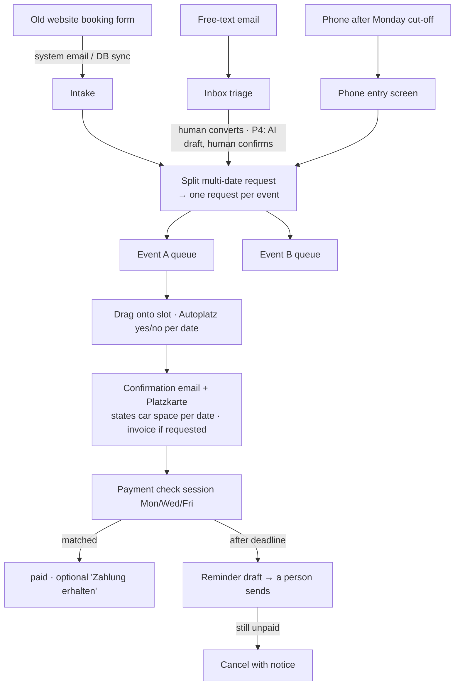

## 10. Payment check session (P2)

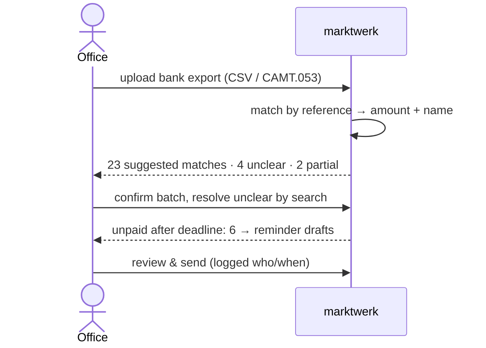

## 11. Rentals & shortages (P2)

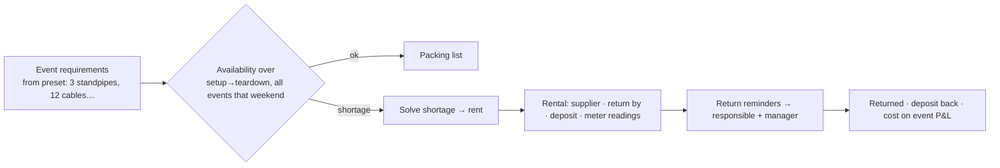

## 12. Market day in the field (P3)

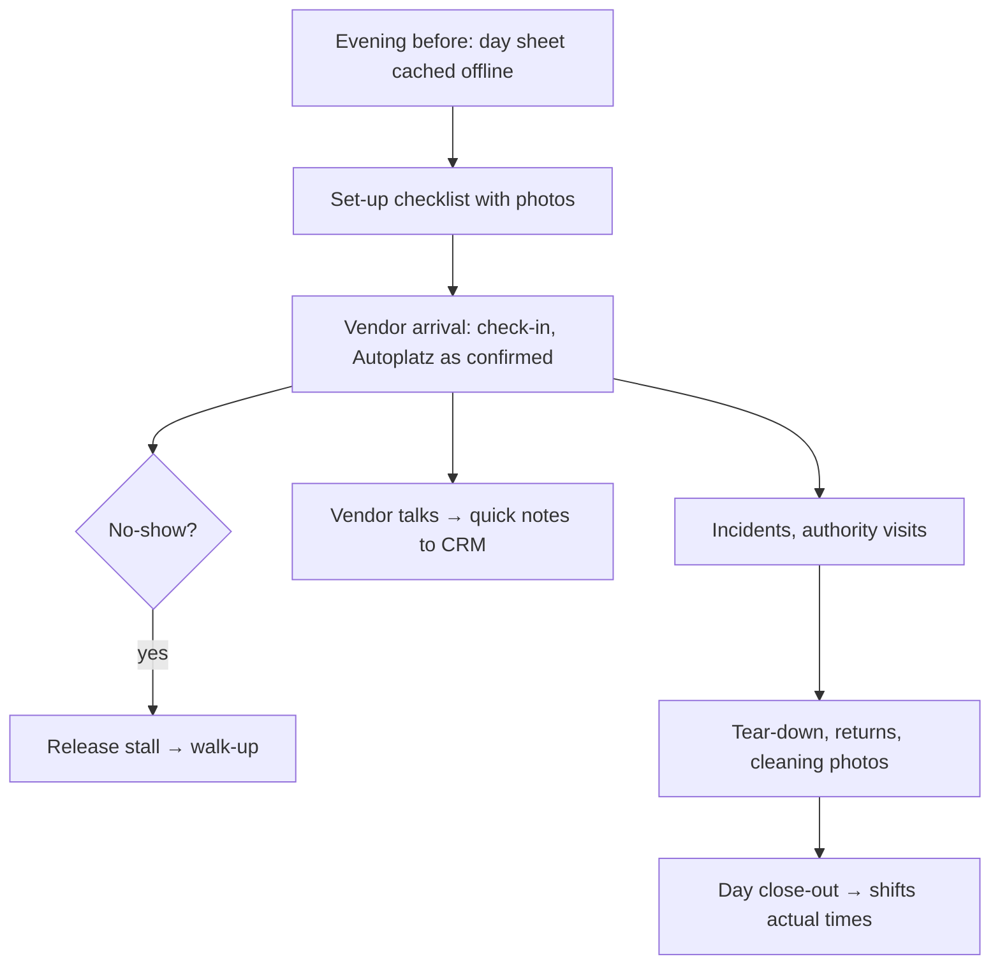
