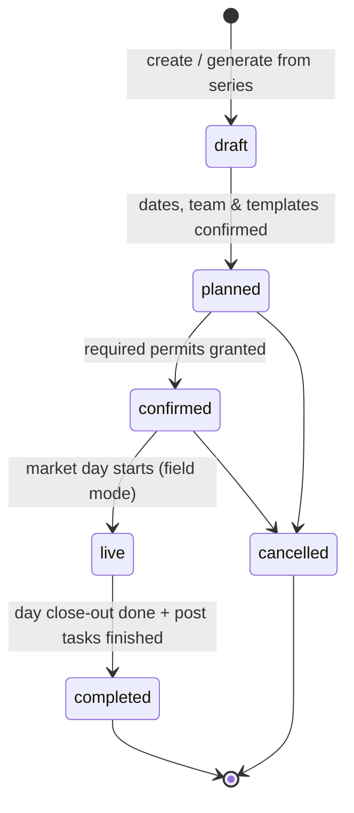
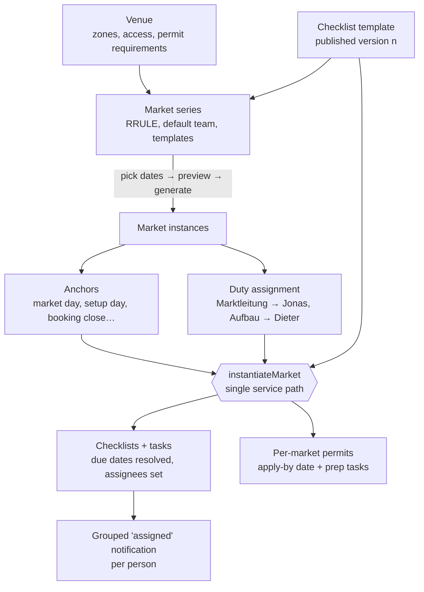
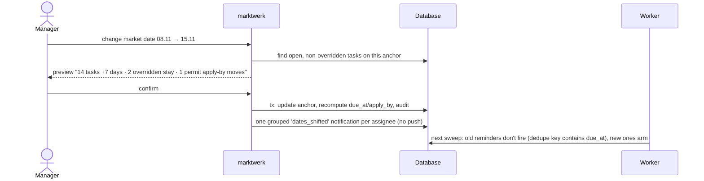
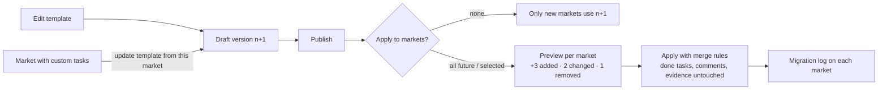
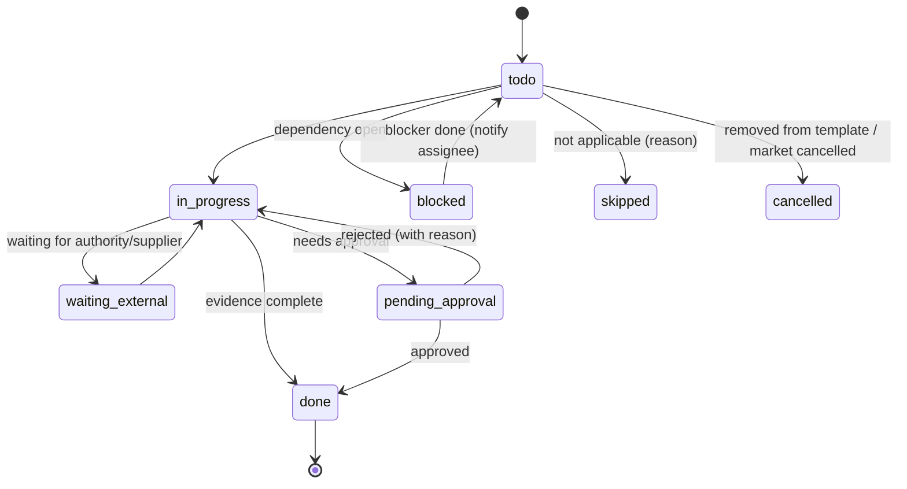
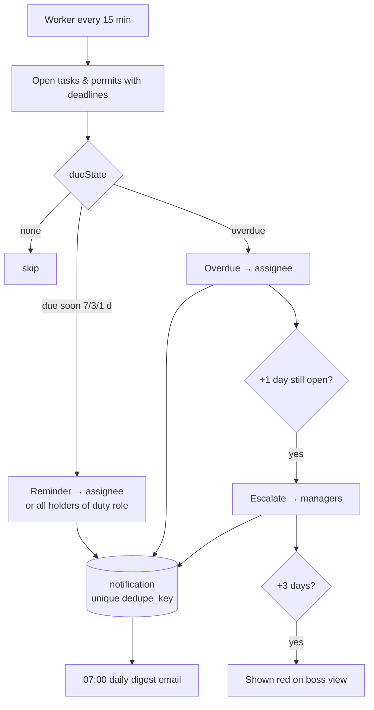
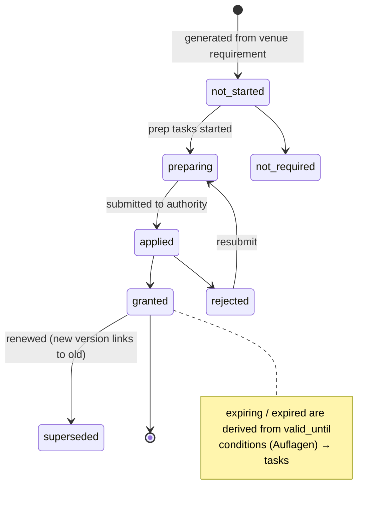
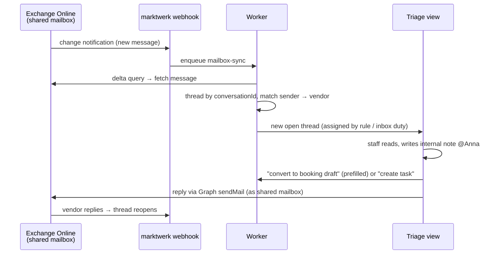
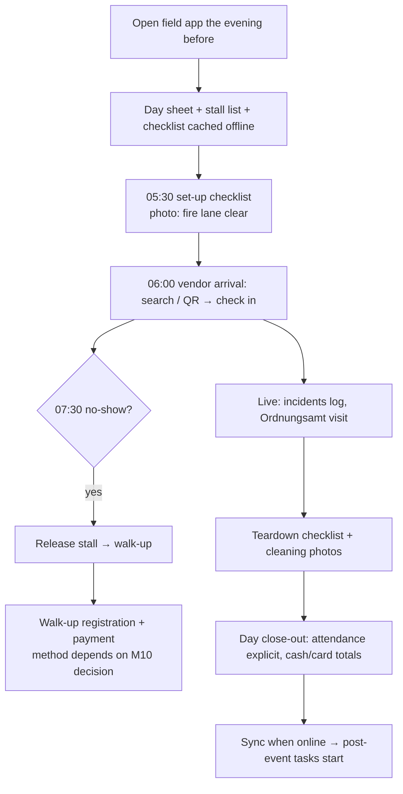

# User flows

Mermaid diagrams render on GitHub and in most Markdown viewers. Phase markers: **P1** MVP,
**P2** bookings & inbox, **P3** market day & map.

## 1. Market lifecycle (P1)



## 2. From blueprint to tasks (P1)



## 3. Moving a market date (P1)



## 4. Template change propagation (P1)



## 5. Task lifecycle (P1)


(`pending_approval` is stored as `status = done` + `approval_status = pending`.)

## 6. Deadline sweep & escalation (P1)



## 7. Permit lifecycle (P1)



## 8. Booking pipeline (P2)

```mermaid
flowchart TD
    F[Public booking form] --> IN[booking: submitted]
    EM[Email in shared inbox] -->|convert to booking| INQ[booking: inquiry]
    PH[Phone / walk-in] --> INQ
    INQ --> IN
    IN --> RV{Review<br/>caps · documents · history}
    RV -->|missing info| NI[needs_info → vendor fixes]
    NI --> RV
    RV -->|over cap / full| WL[waitlisted]
    RV -->|no| DC[declined + reason]
    RV -->|yes| AP[approved]
    AP --> PL[Placement: proposed → held → assigned<br/>row + metre interval]
    PL --> INV[Invoice draft → released<br/>GiroCode + reference]
    INV -->|payment matched (CAMT)| PD[paid]
    INV -->|overdue| DUN[reminder → release hold]
    PD --> AR[Arrival info mail T-3]
    AR --> DAY[Market day: checked_in / no_show]
```

## 9. Email triage (P2)



## 10. Market day in the field (P3)


